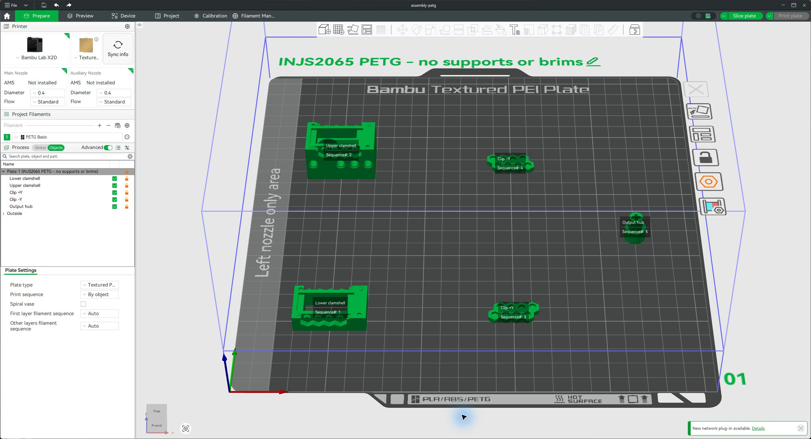
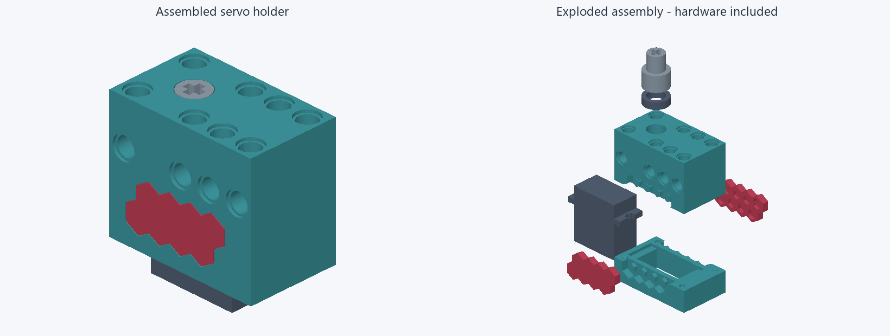
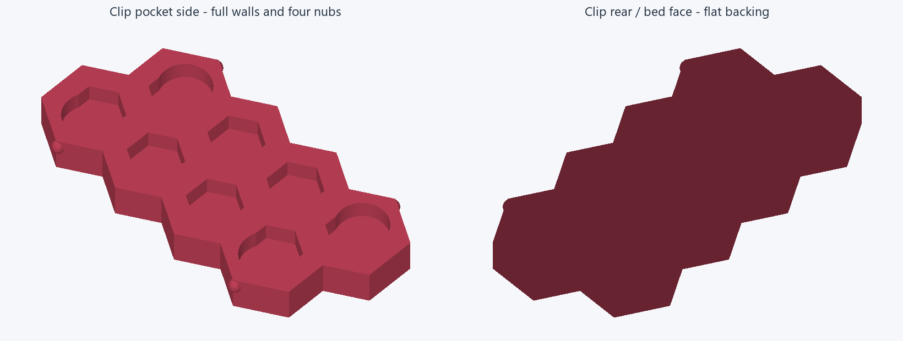
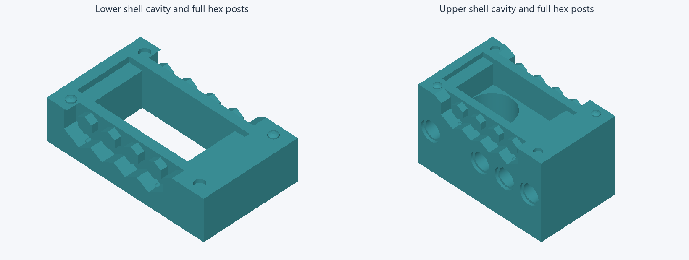
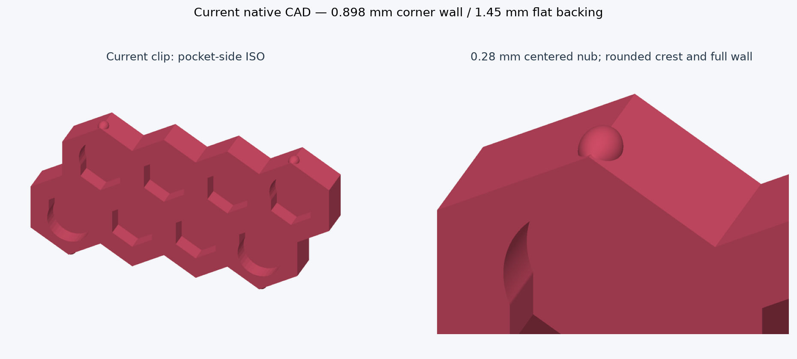
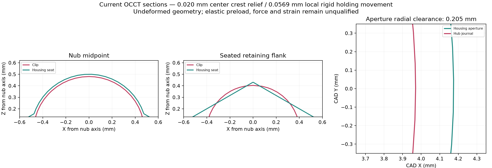
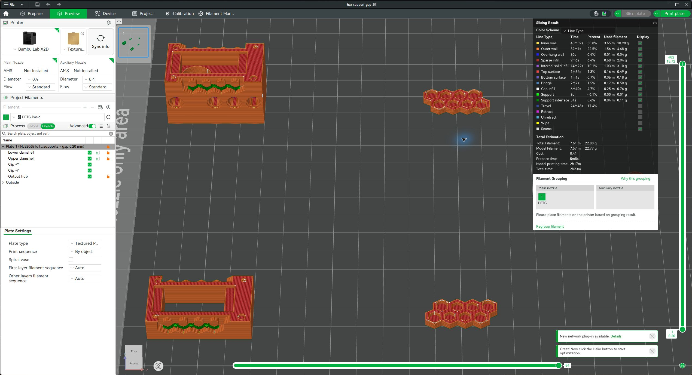
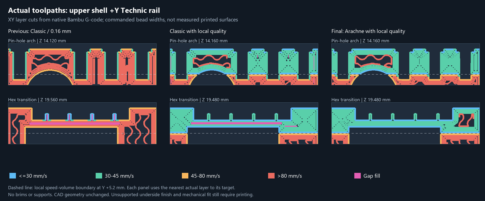

# Current design and print specification

The editable CAD describes the fitted geometry. Use [assembly-uniform-shells.3mf](review/grooves-20261105/assembly-uniform-shells.3mf) for the current confirmation print; the older projects under `print/` retain the superseded regional modifiers. Dimensions below are millimetres unless stated otherwise. [dimensions.json](review/current/dimensions.json) contains the geometric values; it deliberately leaves qualified elastic preload, force and strain unset.

## Current review and print decision

**2026-11-06 update:** the owner reports reasonable printed fit, with end grooves traced to regional slicer modifiers. The [revised all-parts review](review/readiness-20261106/README.md) verifies the unchanged printable meshes and restored end-wall paths. Proceed with a confirmation PETG print of the revised assembly. End finish, repeated clip retention and loaded hub operation remain to be accepted physically.

The earlier geometry review recorded successful CAD replay, export preflight and native slices. Its receipts below describe the historical projects. A newer installed CAD build now produces different shell mesh hashes on replay; it has not been qualified as an identical export. The saved model and prepared print geometry have not been overwritten. The fitted design has full hex posts, 0.28 mm nubs and 0.205 mm radial aperture clearance.

On the next print, inspect the unsupported hex undersides for sagging and roughness without shaving the retaining surfaces. Check both clips for full seating, a snap, no loose sliding or wobble, and no whitening or permanent set. A loose or damaged fit fails this test; measure the printed features before making another dimensional adjustment. Then check the hub's friction fit and bearing-supported rotation as described below. PETG results do not qualify PLA.

[Export preflight](review/current/export-preflight.json) reports no timeline errors and five printable occurrences; the servo and bearing are intentionally excluded. Its layout check uses conservative mesh bounds, not exact sequential-print head collision analysis. The saved assembled, exploded and print-by-object CAD views remain present; the hub is flipped in both the CAD print view and the slicer layout.

[Saved-project verification](review/current/print-project-check.json) confirms five closed, connected, positive-volume assembly meshes with consistent edge winding, matching four-part fit-test meshes with no support paint, and the object settings described below. The native CAD file's model matches the canonical JSON, and the slice receipts match the current 3MF hashes. Portable CAD export does not carry these Bambu process overrides: use the prepared print projects.

The reviewed GUI slice shows all five objects, no supports or brims, the flipped hub, and an estimate of 3 h 29 min / 23.69 g. It used the saved X2D 0.4 mm profile; live printer/AMS configuration was not synchronized. No printer job was sent.

## Current inspection views

These renders use the current CAD/export meshes, with a depth buffer; they do not alter geometry. The assembly overview includes the reference servo and bearing. It starts from the saved exploded-view offsets, then lifts the bearing and hub clear of the upper shell for visibility. The enlarged corner and native OCCT sections below show the critical mating details; deformation is not simulated.

## Clip, detent and housing

Each clip has two rows of four blind hex pockets, full walls, flat pocket floors and four centered rounded nubs. All 16 housing hex posts retain their full 1.70 mm projection, without underside bevels. There are no detent grooves or backing indents.

The nub protrusion is 0.28 mm, with a 0.80 mm crest curve radius, 0.20 mm blend radius and 1.4664 mm meridian span. The minimum corner wall in the clip plane is 0.897584 mm; flat backing is 1.45 mm. Inner hex clearance is 0.10 mm per flat. The receiving seat has a 0.50 mm radius and 0.020 mm crest-center relief; its cap starts at absolute CAD Y = 9.809663 and ends at 10.309663.

The intended flex is inward toward the pocket, perpendicular to the clip's broad face. This is a backed, closed frame, not an isolated free cantilever. Undeformed local holding clearance movement is 0.056926 mm and the flank-crossing axial geometric envelope is 0.39933 mm. Neither is an accepted elastic deformation or an actual dynamic insertion displacement. Rigid installed geometry has four expected clip/housing overlap pairs of about 0.002292 mm³ each; overlap volume is not a force prediction.

## Hub and rotating clearances

The servo socket matches the garden auger's trial dimensions: smooth Ø5.70 × 3.70 mm, friction fit only, with 0.15 mm entry chamfer and 3.55 mm straight engagement. It has no added tabs, center screw or separate horn. The confirmed Technic cross has 4.85 mm overall span, 1.85 mm arms and 8.00 mm depth. The separating web is 3.80 mm.

The hub journal is Ø7.94 mm and stationary housing aperture Ø8.35 mm: 0.205 mm radial clearance. The Ø8.00 mm bearing bore gives 0.030 mm nominal journal clearance. Overall housing-to-hub minimum clearance is 0.150 mm, a different measurement from aperture clearance. A checked Z = 40 section has 4.614 mm remaining material; this is not a global minimum-wall or strength result.

## Saved print settings

Both projects use Bambu X2D, a 0.4 mm nozzle, Bambu PETG Basic and a textured plate at 70 °C. Nozzle temperatures are 245 °C initially and 250 °C thereafter. [bambu-petg-basic.json](print/bambu-petg-basic.json) preserves the resolved material settings for native command-line slicing.

The main process requests 0.16 mm layers, 0.20 mm first layer, four walls and 25% gyroid infill. The narrow clips slice solid. The output hub alone uses 0.08 mm layers, six walls, 100% infill, outer walls at 30 mm/s and inner walls at 60 mm/s. It is oriented servo rim down and Technic cross up. Its 5.70 mm roof bridges without supports, using thin bridges, bridge flow 0.90 and bridge speed 25 mm/s.

Both projects disable supports globally and on every object. Native support paint and shell support overrides have been removed; brim type is none, brim width is zero and skirt loops are zero. The saved overhang slowdown and cooling remain in place. No auxiliary support material has been assigned.

The full 1.70 mm hex posts retain unsupported cantilever undersides. These are not all two-ended bridges: slowing and cooling can help, but successful slicing does not establish underside quality or fit. Inspect this area on the complete-shell fit test. If support becomes necessary, the intended fallback is a confirmed PETG-compatible interface material on the auxiliary extruder. Its material and nozzle mapping must be established before enabling that fallback; ordinary PETG local supports are not configured.

Fresh Bambu Studio 02.08.02.61 slicing succeeds for both projects without a reported warning. Assembly prediction is 12552.04 seconds and 23.6921 g; the four-part complete-shell fit test is 10440.26 seconds and 22.4629 g. Native receipts are [assembly-slice.json](review/current/assembly-slice.json) and [fit-test-slice.json](review/current/fit-test-slice.json). [Toolpath evidence](review/current/toolpath-check.json) records zero support, brim and skirt features. Meshes and object placements were compared independently with the prior committed projects and are unchanged after removing support-paint attributes.

## Local quality around Technic interfaces

Both projects now include two non-printing modifier volumes on each shell, one along each side rail. Their local bounds are X = -21 to 21 mm and Y = -12.5 to -5.2 mm / 5.2 to 12.5 mm, over the full shell height. They extend into supporting rail material and cover the Technic pin interfaces and adjacent hex transitions. They do not add printed geometry or change dimensions, wall count, infill density, temperature, cooling or support policy.

The modifiers request outer walls at 30 mm/s, inner walls and internal solid infill at 45 mm/s, gap fill and top surfaces at 30 mm/s, and small perimeters at 25 mm/s. All six nullable nozzle/flow entries are explicitly populated. A first scalar-only trial was rejected because its emitted G-code did not honor these values; the retained projects pass actual toolpath checks. Smoothed overhang transitions can reach 40 mm/s on outer-wall-labelled paths despite the 30 mm/s nominal setting. Rail outer-wall median is 30 mm/s, inner-wall maximum is 45 mm/s and gap-fill maximum is 30 mm/s. No acceleration, material compensation or mating dimensions were changed.

Detail bands use 0.12 mm layers in oriented build coordinates: lower shell Z = 5.0 to 10.95 mm; upper shell Z = 0.2 to 3.6, 8.5 to 15.5 and 18.0 to 24.45 mm. The upper side-hole axes are at Z = 12 mm with nominal 5.05 mm diameters, so the 8.5 to 15.5 band encloses their arches with margin. The hex bands begin below the previously sampled first tip layers (lower 5.96 mm / upper 19.40 mm). Height bands affect the whole shell cross-section at those heights; elsewhere shells retain 0.16 mm layers and the first layer remains 0.20 mm. The hub retains its separate 0.08 mm process.

Arachne is adopted for both shells. With the same modifier volumes and detail bands, inspected rail gap-fill segments fall from 11,979 with Classic to 52 with Arachne. Inner-wall widths in the final rail screen span 0.346552 to 0.741112 mm, and outer-wall widths span 0.352272 to 0.627082 mm. Some short gap-fill paths remain below nozzle width; their presence does not qualify printed material continuity. Segment counts depend on path subdivision and are not physical defect counts. The benefit is fewer separate gap-fill fragments and variable-width walls through changing thicknesses, not an increase in geometric wall thickness.

Classic is explicitly retained for both clips and the hub. Their geometry, width, extrusion and commanded-speed segment multisets match the prior assembly slice (excluding non-part custom machine commands). All original printable mesh payloads match the prior committed projects byte-for-byte, and build placements are unchanged; only settings and non-printing modifier volumes were added. CAD hashes are unchanged. Both final native slices return success with no reported warning, and saved-project closure/settings verification passes.

The assembly was also reopened from its canonical file and sliced in the GUI. Its 3 h 29 min / 23.69 g prediction matches the native Arachne result, and the speed preview was inspected. The process preset-change metadata explicitly includes `wall_generator`; without this flag GUI reload restored the system preset's Classic generator despite the resolved command-line configuration. Saved-file verification now checks that flag and shell inheritance. The final screenshots and local-quality receipt record the reviewed state.

[Local quality evidence](review/current/local-quality-check.json) records the Classic/Arachne comparison and final toolpath checks. Run `python tools/slice-print.py` for fresh native slices and actual path checks. It compares clip/hub extrusion fingerprints against the accepted baseline without requiring old Git history. Add `--update-evidence` to refresh matching receipts after both projects pass. To independently rebuild that comparison, add `--baseline-ref 3aabeafb9dcde4209b8b2af6134a0e2ff26f72af` in a checkout containing that commit. Run `python tools/verify-print.py` for saved settings, modifier attachment/bounds/transforms and receipt consistency; `python tools/test-print-contracts.py` exercises misplaced and disconnected modifier failures. Configuration is reproducible with `python tools/configure-local-quality.py --output-directory print`. Inspect speed/line-width preview at modifier boundaries and pin-hole arches; numeric checks do not qualify printed finish.

This completes the slicer implementation and software validation. Printed pin fit, thin-wall continuity, unsupported underside finish and snap retention remain physical acceptance checks. No printer job was sent.

## Mechanical confidence and remaining checks

### Contact-path follow-up

The current 0.28 mm candidate has not yet been printed, as confirmed by the user. A new [native contact-path audit](review/current/contact-path.json) moves both clips along their opposing CAD Y directions in a disposable headless document. It samples 20 poses with exact OCCT overlap queries, then restores the installed poses and checks all seven source meshes/topologies against the current reference. The saved CAD and print projects are unchanged.

At the installed pose, total rigid overlap across the four shell/clip pairs is 0.009168 mm³. Outward movement increases it to a sampled plateau of approximately 0.323544 mm³ at 0.8, 1.2 and 1.6 mm; it falls again near exit. The 2.5 mm sample still overlaps (0.008671 mm³ total), whereas the 2.6, 2.7 and 2.8 mm samples are clear. Opposing clips agree within 0.000001 mm³ at every sampled pose. This establishes a nominal geometric obstruction on this straight withdrawal path and a comparatively relieved seat. It does not establish a continuous collision boundary, elastic energy barrier, insertion force, holding force or actual deformation distance. Small numerical differences across the plateau do not identify a meaningful unique peak position.

Moving the *whole* clips inward 0.02 mm instead produces 3.398258 mm³ total overlap; at 0.05 mm it produces 8.487109 mm³. This is consistent with substantial supporting surfaces blocking rigid inward motion. The intended deformation must therefore be local, not a whole-clip translation. These whole-solid overlaps neither prove that local flex is impossible nor quantify its available travel. A local nonlinear contact model must allow actual floor/contact release rather than prescribing inward movement to the entire clip.

Recommendation remains to print the prepared complete-shell fit test before increasing the nubs or thinning any more material. If it remains loose, inspect and measure the printed nubs and seats, including sagging or roughness on unsupported undersides. If it is difficult to seat, inspect the corner motion and backing/post contact before attributing the problem to PETG stiffness. Record each clip's seating, snap, wobble, removal behavior and visible permanent set. Quantitative force/strain results remain unset; the rigid sweep does not replace them.

Reproduce this screen with `node tools/audit-contact-path.mjs`. It is specific to the reviewed canonical model hash and fails on missing contact pairs, asymmetric overlap, source-mesh changes or failure to reach a sampled clear pose.

There is no accepted structural solve for the current geometry. Overconstrained floor/contact studies do not qualify this backed-frame detent, and their force and strain predictions are not carried forward. Bambu PETG Basic V3 reports tensile coupon modulus of 2780 ± 65 MPa in XY and 2550 ± 100 MPa in Z; these are screening inputs, not printed-detent stiffness or allowable cyclic strain. Poisson ratio 0.38 is an assumption.

A useful structural solve must represent unilateral housing contact, the actual flex mode, possible pocket-floor release and the seated state. It needs mesh/contact convergence, deformed-solid penetration checks and insertion-path refinement. Quasi-static insertion is distinct from impact dynamics; creep and fatigue need separate treatment and printed calibration.

Before accepting the part, inspect the unsupported undersides and check full seating, a perceptible snap, closed seams without hand restraint, no loose sliding or wobble, and no whitening or permanent set. Check hub rotation with the bearing fitted, full servo engagement, friction-fit axial retention and torque transmission. Repeat insertion cycles and a holding dwell, then measure printed nub and seat dimensions before any further increase. No printer job has been started by this review.

The regression check replays all 374 features with no native errors and preserves seven current meshes/topologies plus expected assembly contacts. All five exported print meshes are closed, connected and positive-volume at the recorded tolerance; this is not an exhaustive self-intersection check. The native saved project's model matches the canonical JSON. These checks establish geometric consistency and sliceability, not mechanical qualification.
