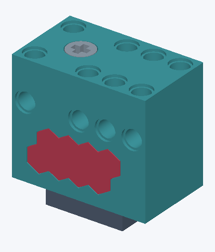
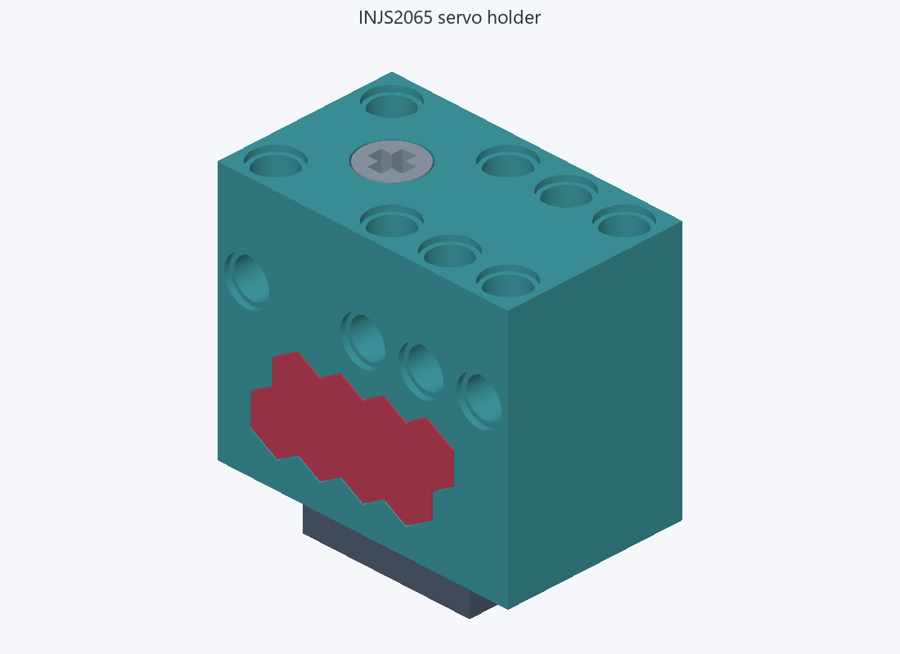
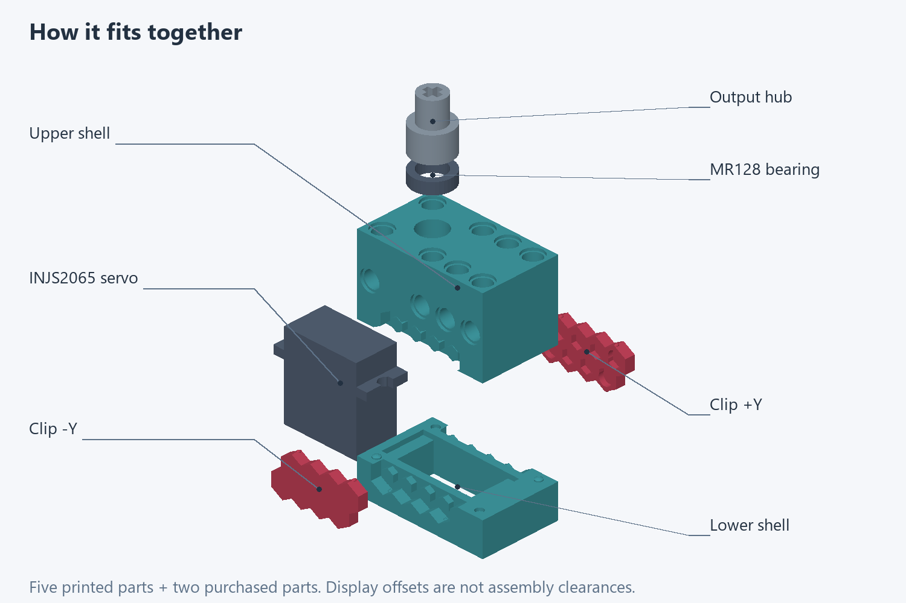
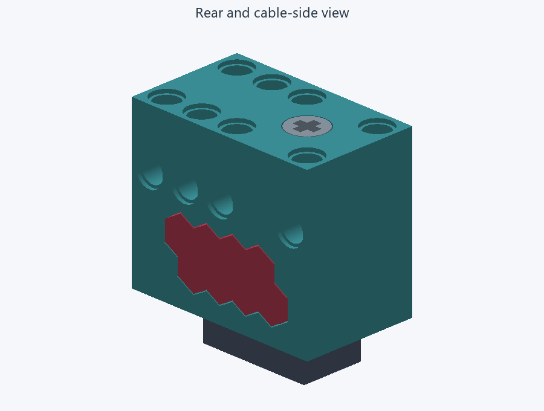
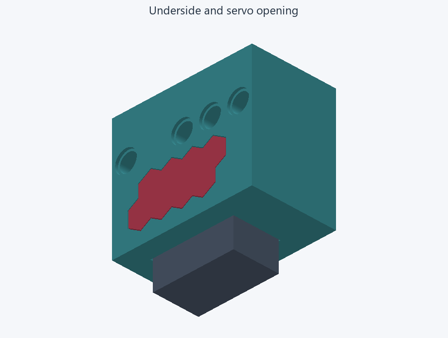
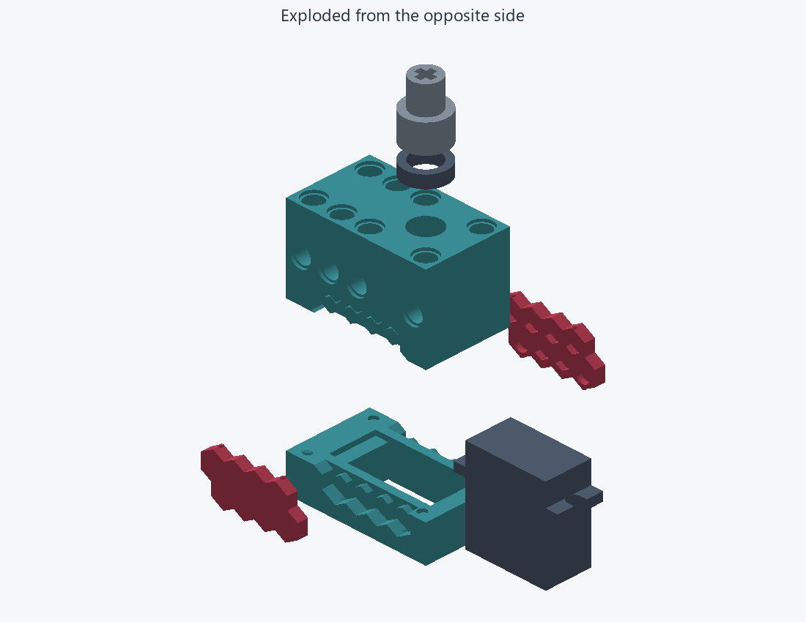
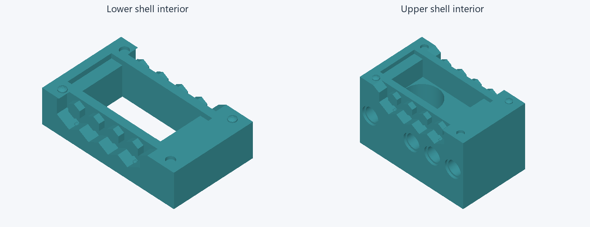
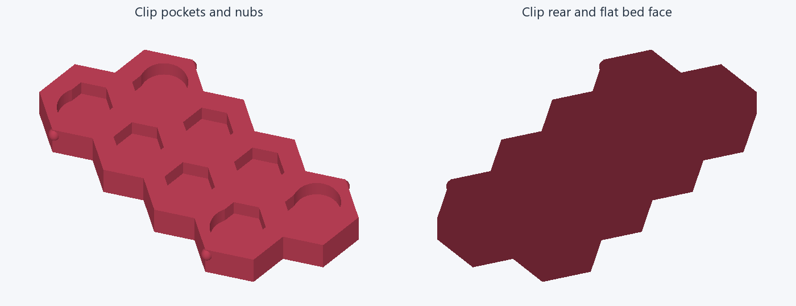
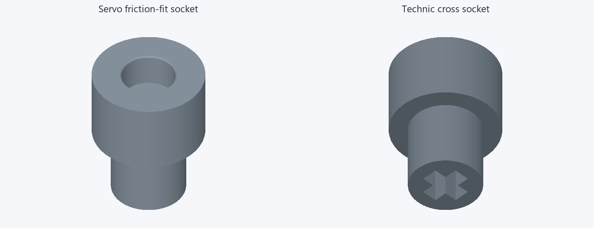
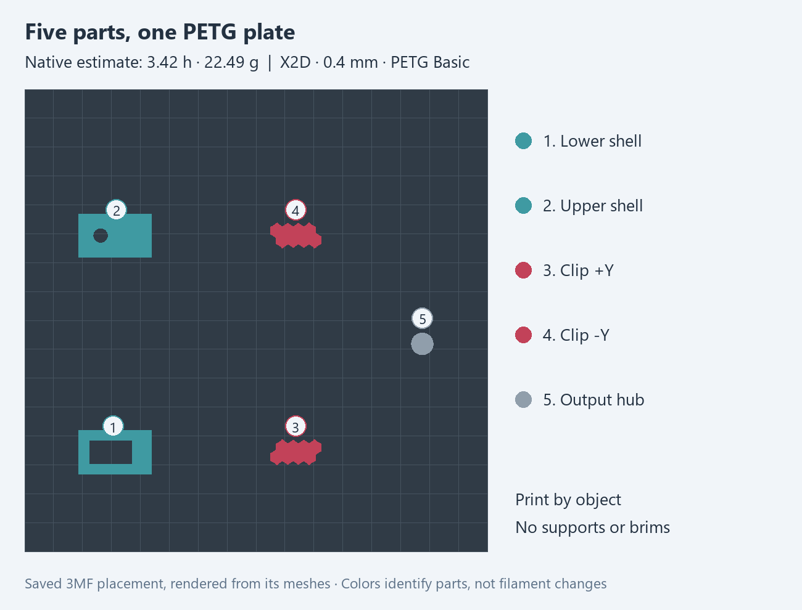

# INJS2065 servo holder for LEGO Technic

A printable clamshell that holds an INJS2065 servo in a Technic build. Two retaining clips close the housing, and a bearing-supported output hub connects the servo shaft to a Technic cross socket.

See a still assembled view

## The parts

- Upper and lower shells with Technic mounting holes.
- Two hex-pattern retaining clips with rounded snap nubs.
- An output hub with a servo friction-fit socket and a Technic cross socket.

Print the **five plastic parts in PETG**. The servo and bearing are not included on the print plate.

## Bill of materials

Purchased parts:

- **1 × INJS2065 servo**
- **1 × MR128 bearing** — 8 mm bore × 12 mm outer diameter × 3.5 mm width

## Inside the holder

See the assembled rear, underside and opposite exploded view

Look closer at the clips and output hub

## How we made it

We designed and refined the holder in **[Limo CAD](https://github.com/limo-cad/Limo-CAD)**, exported the parts, then prepared the PETG print project in Bambu Studio. The editable model and saved print settings are included so you can adapt the holder to your own build.

The owner reports reasonable printed fit but inadequate snap retention. The print project uses slower speeds across each whole shell, with continuous end-wall paths; the retaining geometry still needs a successful physical test.

## Print plate

The current project uses **Bambu X2D, a 0.4 mm nozzle and Bambu PETG Basic**, printing by object without supports, brims or skirts. Native slicing estimates **3 h 25 min and 22.49 g**.

The next step is a **controlled retention fit test**. Identify the printed revision and measure the mating features before choosing another detent increment. Use complete, aligned shells and reuse sound printed parts where possible. Confirm end finish, clip seating and retention, and hub engagement and bearing rotation before putting it into service. Snap retention and loaded operation are not accepted.

## Make your own

- [Editable Limo CAD model](design/current.nbcad)
- [Bambu Studio print project — all five parts](print/servo-holder.3mf)
- [Matching editable model JSON](design/current.model.json)

[Assembly notes](docs/assembly.md) · [Design and print workflow](docs/workflow.md) · [Dimensions and fit](DESIGN.md) · [Validation](docs/validation.json)
