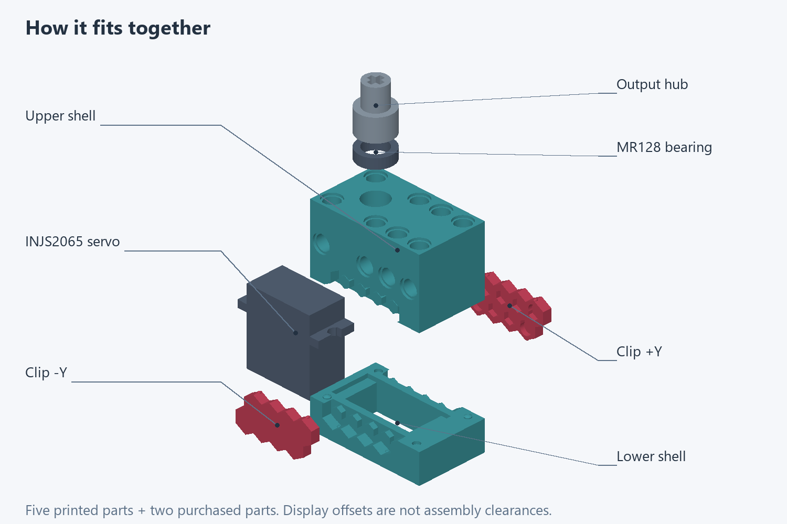
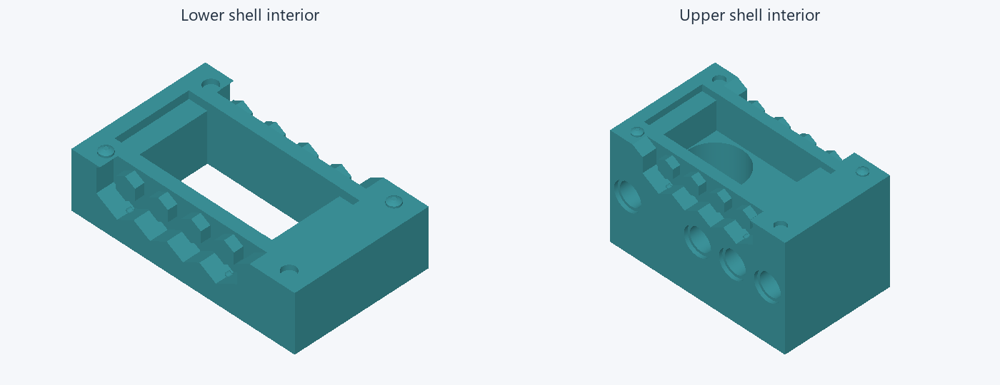
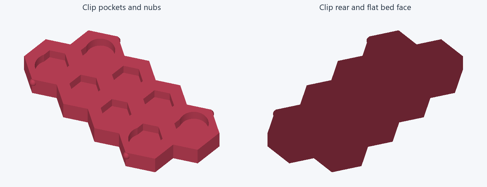
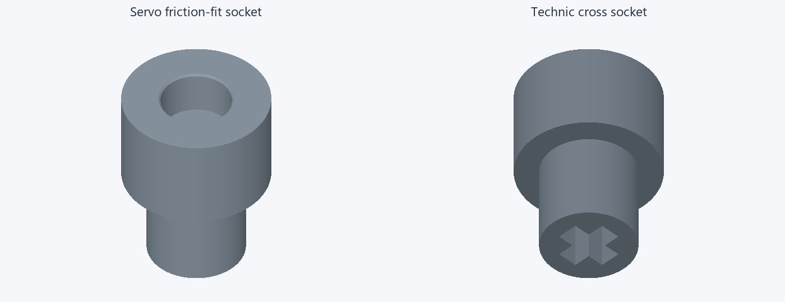

# Assembly

Print the lower shell, upper shell, Clip +Y, Clip -Y and output hub in PETG.
Add the purchased INJS2065 servo and an MR128 bearing: **8 mm bore × 12 mm outer
diameter × 3.5 mm width** in the reference model. The housing closes with
the two clips; there are no housing screws in this design. The hub grips the
servo shaft by friction, without a center screw or separate horn.

## Put it together

1. Inspect the printed cavities, Technic holes and hex features. Remove loose
   printing debris, and check the unsupported hex undersides for sagging or
   roughness before forcing a clip onto them. Preserve the retaining surfaces.
2. Place the servo in the lower shell and keep its cable clear of the mating rim.
3. Seat the bearing in the modeled housing location and engage the hub with the
   servo shaft, with the journal running through the bearing. The large smooth
   socket faces the servo; the Technic cross socket faces out.
4. Close the upper and lower shells. The seam should close without continued
   hand pressure, and the output hub should rotate freely with the bearing fitted.
5. Fit the two clips over their matching side hex features. Check full seating,
   a perceptible snap and retention without loose sliding or wobble. Stop if
   the clip whitens, cracks or takes a permanent set.

## Output connection

The servo socket is nominally 5.70 mm in diameter and 3.70 mm deep. The
Technic cross socket has a 4.85 mm overall span, 1.85 mm arms and 8.00 mm depth.
The hub journal is nominally 7.94 mm in diameter for the bearing's 8.00 mm bore.
These are CAD dimensions, not guaranteed printed fits. See [the design record](../DESIGN.md#hub-and-rotating-clearances)
for the complete dimensions and clearances.

## Accept the next print

The owner reports reasonable printed fit but inadequate snap retention on the
last print. No successful snap-retention result is recorded for the current
design. Identify the printed revision and measure the printed nub, seat and
free play before choosing another detent increment.

Test with the complete shells fully aligned and seated. Reuse sound printed
parts where possible. A cropped receiver that omits the locating features is
not a valid substitute. Printed surface finish also needs confirmation.

Check both shell ends for continuous surfaces without repeated grooves.
Check full seam closure, clip seating, free rotation, servo engagement,
torque transmission and axial hub retention under the intended load. Repeat
insertion/removal cycles and a loaded holding dwell, inspecting for loosening,
whitening or permanent set. Do not infer a holding force or lifetime from a
successful slice or a single good fit. PETG results do not qualify PLA.
