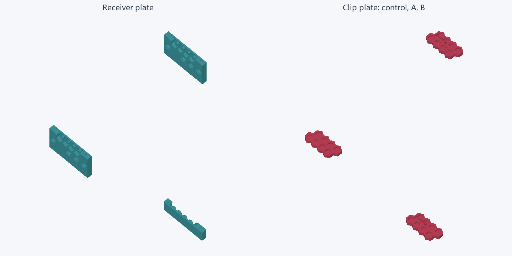
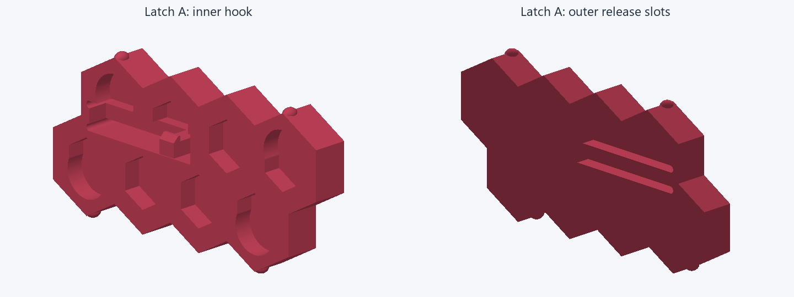
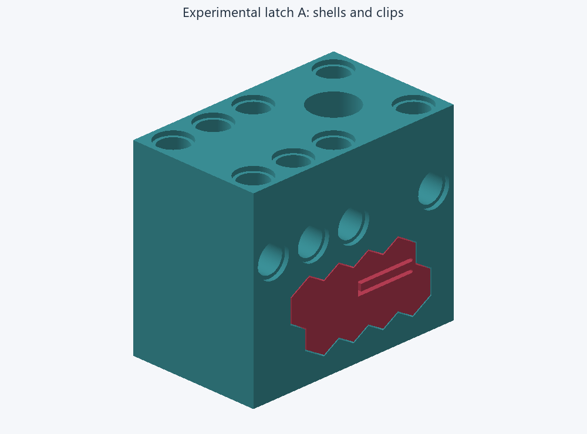

# Printed retention trial

**Print the coupons first. The latch is experimental and has not been physically
accepted.** The last clips slid into place without a snap and remained loose.

Open [coupons-receivers.3mf](../print/retention/coupons-receivers.3mf) and
[coupons-clips.3mf](../print/retention/coupons-clips.3mf) in Bambu Studio. Together
they contain six pieces in Bambu PETG Basic, with final part orientations and original build
Z coordinates. No purchased hardware is added. No printer job has been sent.

Native slicing estimates **8.65 g / about 1 h 48 min** for receivers and
**2.34 g / 22 min** for clips: **10.99 g / about 2 h 10 min** combined. Actual
consumption and runtime may differ. The complete A holder estimates
**22.36 g / about 3 h 27 min**.

Receiver coupons have a **2 mm outside brim with a 0.1 mm separation gap** to
help the tall, narrow rails stay attached to the plate. This adds about 0.14 g
and 17 seconds. Remove the brim before testing. The clips and complete holder
remain brim-free; no supports or skirts are used on any project.



## What changed

A tongue in each clip's backing can flex toward the lower shell. Its inward hook
has an insertion ramp and a retaining shoulder. The upper shell has a local
pocket behind a lip. At full seating the tongue should relax and the shoulder
should prevent withdrawal. This is the intended behavior, pending printing.



The existing hex centers, spacing and outside envelope remain. Local cuts open
the backing and portions of adjacent pocket walls to isolate the tongue. The
other locating surfaces retain their role. The new receiver cuts are confined
to X=4.8–6.7, Z=18.3–20.85 on each side; Technic mounting holes and their access
remain outside that region. The servo, bearing, hub and lower shell are unchanged
in the full trial print project.

- **A:** 1.2 mm tongue thickness in the flex direction.
- **B:** 1.0 mm tongue thickness; same hook, receiver, root radius and slot width.
- Nominal tongue span: 10 mm; backing depth: 1.2 mm.
- Flex slots: 0.6 mm, with 0.3 mm rounded closed ends.
- Hook projects 0.45 mm above the tongue; nominal receiver overlap is 0.40 mm.
- Nominal withdrawal clearance before the shoulder contacts the lip is 0.15 mm.
  This is a geometric allowance, not a promise of zero printed play. Seated
  looseness remains a rejection criterion.

These dimensions are initial test values. No insertion force, allowable strain,
holding load or lifetime has been established.

## Identify and use the coupons

Part numbers are in the Bambu object names; mark the pieces before removing them
from the bed. On the receiver plate, the lower rail is at (150,55), control upper
at (50,175), and latch upper at (50,55). On the clip plate, the control is at
(50,55), A at (50,175), and B at (150,55), in millimetres. Two plates provide
the clearance Bambu requires for the final print-by-object process.

1. **Lower rail:** shared by every test.
2. **Control upper rail:** use with part 4.
3. **Latch upper rail:** use with parts 5 and 6, separately.
4. **Control clip:** exact prepared mesh from the current holder project.
5. **Latch A clip:** 1.2 mm tongue.
6. **Latch B clip:** 1.0 mm tongue.

Use the lower rail with the selected upper rail. Engage both original pin/socket
registration features and seat the seam fully before installing a clip. Do not
align loose rail pieces by eye, clamp the seam shut to hide a gap, or mix the
control upper rail with a latch clip. The clip must reach its original full-depth
seat; an early catch is a failure.

Each receiver is the complete +Y rail cropped at Y=7.6 mm. Both original end
registration features on that side remain. Nothing is lowered onto the bed:
lower geometry retains Z=8 as its build datum, upper retains Z=42, and the clip
retains Y=12. Original 0.12 mm shell detail bands and clip 0.16 mm layers remain.

**The cropped rails are fit-screening pieces.** Their stiffness and cooling are
not established as equivalent to the complete housing. They can reject an
unworkable latch but cannot qualify strength, zero motion under motor load or
service reliability. Use the complete trial housing for those decisions.

## First physical check

Record the filament, printer/profile, object number and whether any cleanup was
needed. Do not sand or file the contact surfaces during the first comparison.

1. Try the control pair and record insertion feel, seating and looseness.
2. Try A and B with the latch upper rail. Require firm thumb installation, full
   seating, a distinct catch and no perceptible rocking or clicking.
3. Pull the clip straight back without operating the release. It must stay
   captured. Record the test method; hand feel is not a measured holding load.
4. Insert a small flat blade through the slot next to the free end of the tongue.
   Press the tongue toward the lower shell just enough to clear the lip, then
   withdraw the clip. The modeled release travel is about 0.5 mm; do not lever
   against the registration pins or force the tongue against its stop.
5. Repeat ten installation/release cycles as an initial screen. Inspect for
   whitening, cracks, permanent bending and increasing play. Ten cycles do not
   establish lifetime. Photograph and report any damage or forced assembly.

If neither variant passes, stop before printing complete shells. If one passes,
confirm it in complete registered shells around the servo. The full A project is
[holder-latch-A.3mf](../print/retention/holder-latch-A.3mf). It includes all five
printed parts. A successful B result requires preparing the complete B housing
before accepting it; do not infer its performance from A.

The complete assembly must retain the servo without perceptible motion through
repeated motor reversals, vibration and representative bumps, followed by a
loaded holding dwell and another retention/release check. Record the actual
load, reversal count and dwell duration before calling that result accepted.
Servicing may require removal from the Technic mounting before tool release.



## Editable source and checks

Open [latch.limo](../design/retention/latch.limo) in Limo CAD; its matching
[model JSON](../design/retention/latch.model.json) preserves the full assembly and
both modified clips. The current model and print project remain the control.
The original rounded detents remain, but acceptance must come from the new catch.

[Validation evidence](retention-validation.json) records mesh closure, one-piece
connectivity, winding, native replay comparison and hook contact probes. The
release probe translates only the isolated hook end; it is not a deformation
simulation. The native replay comparison samples every mesh vertex plus 4,000
surface points each way; it does not prove exact surface equivalence.

Rebuild in an isolated native process, prepare the projects, then slice:

```text
node tools/build-retention.mjs
uv run --with trimesh --with manifold3d --with rtree --with scipy --with pillow python tools/prepare-retention.py
uv run python tools/slice-retention.py
```

Preparation resets slice evidence; rerun slicing after every geometry change.
`local/retention/` belongs to this project, with a 100 MiB output budget. Retain
it while the trial is active; review for cleanup after results settle and the
tracked models, print projects and evidence are committed. No compiler build or
shared runtime change is required.
