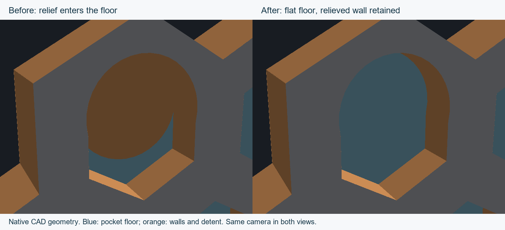
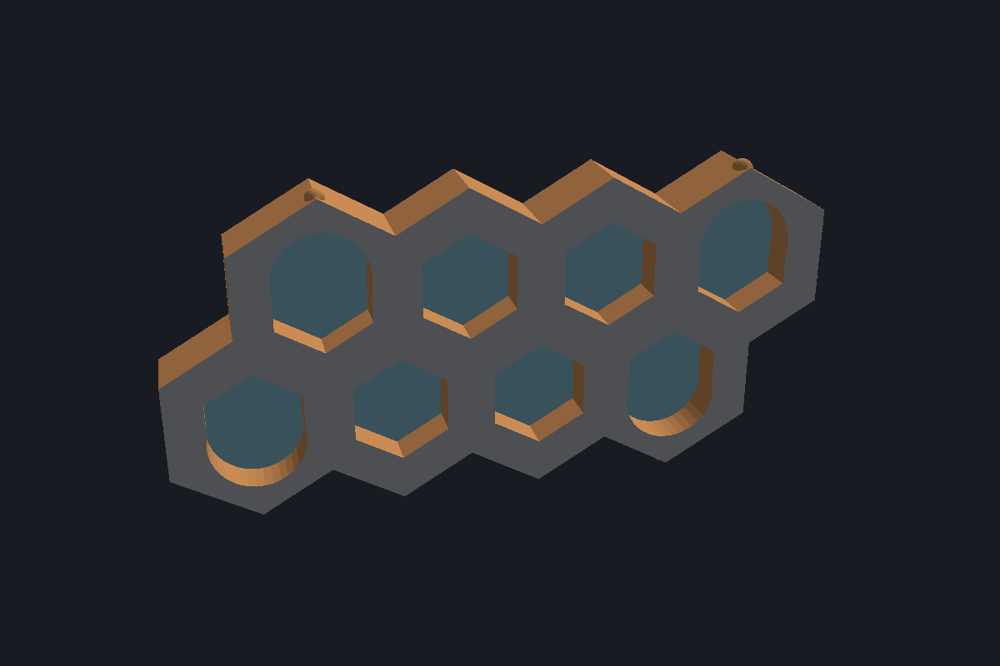
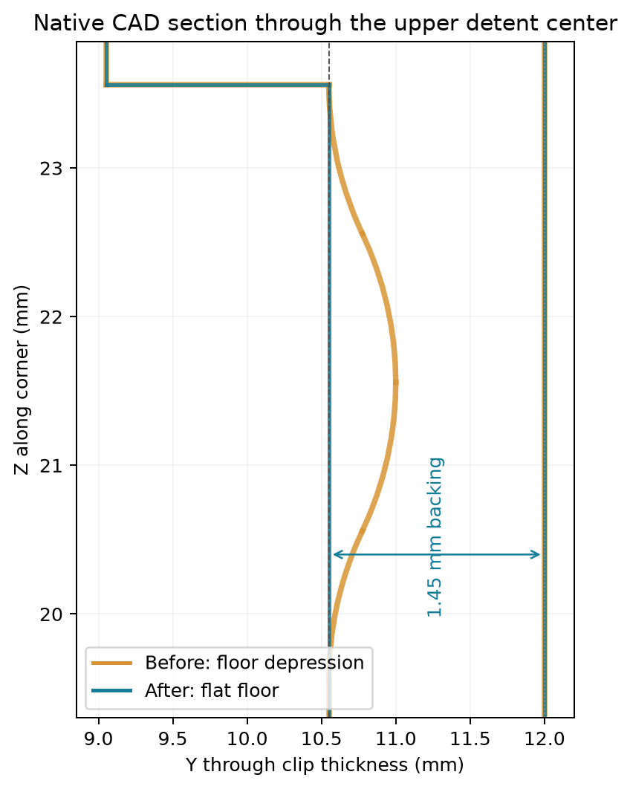
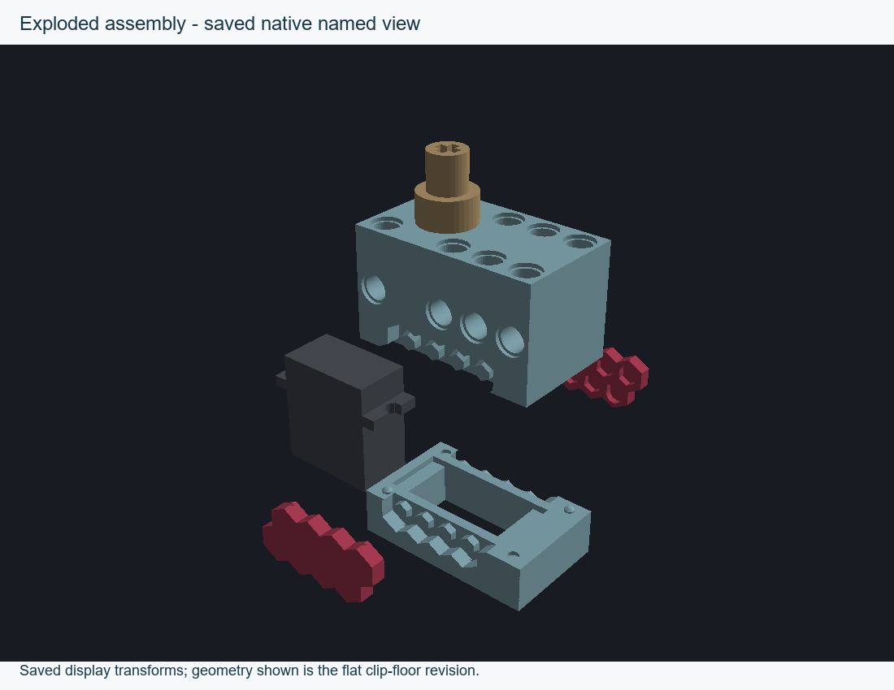

# Flat clip pocket floors ? 8 October 2026

The corner-relief cutters previously entered the clip backing, leaving four rounded depressions in each clip's pocket floors. The existing cutters now stop at the floor, |Y| = 10.55 mm. The broad outside face remains at |Y| = 12 mm, so minimum floor backing is 1.45 mm rather than 1.00 mm. No new features or patch solids were added: the existing relief sketch/revolve were edited and the same eight R0.25 side-wall blends per clip were rebound to their changed edge references.

[Assembled ISO](assembled.png) and [saved print layout](print-layout.png) show the other native named views. Pictures rasterize actual native CAD meshes; the section uses OCCT section polylines. Face colors in the clip closeups distinguish the floor from the relieved wall.

The R2 relief footprint, 0.8976 mm minimum in-plane corner-wall thickness, R0.25 side-wall blends and detent nub geometry remain. Native sections at |Y| = 9.3, 9.8 and 10.3 mm match the previous clip sections at 0.000001 mm coordinate rounding on both clips. Behind the new floor, the |Y| = 10.6 mm section has the complete backing outline with no pocket-floor holes. Five other native meshes/topology signatures, all assembly placements and all saved view definitions are unchanged. The four intended detent interference-pair volumes agree with the preceding revision within 0.000000001 mm?; no additional interference groups appear. All 390 features replay without errors into seven bodies.

[Geometry checks](geometry-audit.json), [assembly interference](candidate-fit.json), [print checks](print-audit.json) and [new independent validation reference](../flat-clip-base.json) record the reviewed revision. Earlier references are retained unchanged. Run `node tools/verify-current.mjs` from the repository root.

[Current full PETG project](assembly-petg-flat-clip-base.3mf) uses the same X2D / 0.4 mm nozzle, Bambu PETG Basic, spaced print-by-object layout and per-part settings as its parent. Both shell and hub mesh entries are byte-identical to the parent; only the two clip mesh entries and their triangle-count metadata change. All five meshes are closed, consistently wound and connected. Both clips still slice solid, at 0.12 mm layers after the 0.20 mm first layer, without supports. The hub retains 0.08 mm layers, six requested walls, solid fill and tree supports without a brim. The native full-plate slice succeeds without warnings, estimating 2 h 58 min 50 s and 23.016 g. No print job was started.

Restoring the floor is a local geometry correction, not a new mechanical qualification. Wall sections and nominal nub/seat contact are preserved, but the thicker support can change flex stiffness and snap force. Earlier force, strain, creep and fatigue estimates do not qualify this revision; check snap insertion, retention and release on the next fit-test print.

Source commit: `645a22f`. See [source hashes](source.json) and [assembly manifest](assembly-project.json). Full source/export scenes and G-code remain in `D:/noBS-CAD-Reviews/INJS2065-Technic-Case/flat-clip-base-20261008`.

The [native rebuild](rebuild.mjs) recreates the reviewed feature data without adding history operations. Supply the pre-change model as its first argument, recovered from `git show 645a22f:design/current.model.json`; the omitted argument uses the active canonical model. [Validation](validate.mjs), [native slicer export](slice-flat-floor.py), [print audit](audit-print.py), [rendering](render-review.py) and [section plotting](render-section.py) use the documented local CAD client and the external review workspace. These scripts have explicit local paths; they are reproducibility evidence, not portable application code. The cleaned rebuild was run from the pre-change source, and its sketch, revolve, fillet, body-feature, assembly and view data match the reviewed model exactly.
