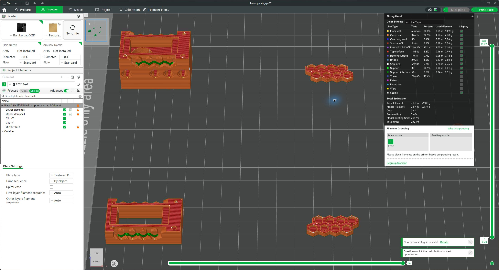
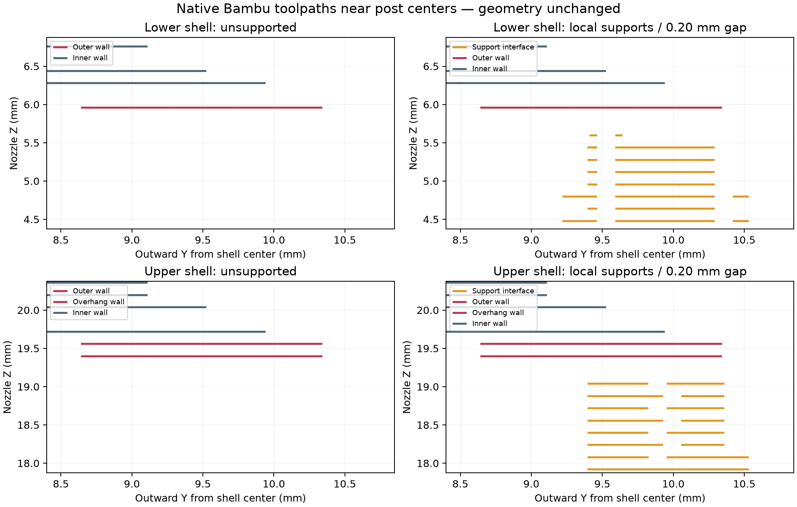

# Local hex support test — 10 October 2026

The selected [complete PETG project](assembly-petg-local-hex-supports.3mf) preserves the current full hex geometry and adds native painted support enforcers only on the two downward-facing flanks of each housing hex post. All 16 posts have local support interfaces in the generated toolpaths. This is a print test candidate; PETG removal quality and the resulting hex fit still require a physical test. No printer job was sent.

## Source and changes

Source: `review/incremental-fit-20261010/assembly-petg-incremental-fit.3mf` at part commit `d61d3ad`. CAD JSON SHA256 remains `0a2c7fece94665ea40207f6ad02bcbf55774debcdd0a8dd09387bb2cfa75e1c7`; native archive SHA256 remains `8d7471dd020aa44d772c6baddaf56123c916b0da70e69e825cbcc374085e0478`.

Only the two clamshell objects receive overrides: normal (manual), snug supports; support may start on the housing surface; Remove small overhangs off; Don't support bridges off; three top interface layers at 0.20 mm spacing; two bottom interface layers at 0.20 mm spacing; top/bottom Z separation 0.20 mm; XY separation 0.35 mm. Support material remains the same PETG Basic. A zero interface gap was not selected. There are no brims.

Each shell has 32 enforced original mesh triangles (four per post) and every remaining triangle is explicitly blocked. The markings are native Bambu `paint_supports` attributes, so they remain editable in Studio's support painting tool. No triangle splitting, vertex movement, added solid or CAD feature is involved. The global X2D / 0.4 mm / Bambu PETG Basic settings, build transforms and three other object definitions remain unchanged. Hub-only thin-bridge tuning remains unchanged.

## Comparison and validation

The exact installed Bambu Studio 02.08.02.61 sliced both alternatives successfully without native warnings. Native estimates:

- Existing unsupported source: 2 h 21 min 18 s, 22.7719 g.
- [0.16 mm top-gap comparison](comparison-gap-016.3mf): 2 h 22 min 37 s, 22.8870 g.
- Selected 0.20 mm top-gap test: 2 h 22 min 37 s, 22.8841 g — approximately 79 seconds and 0.1122 g more than the source.

The larger gap is selected as a starting point for same-material PETG separation, not as an experimentally proven optimum. Both alternatives cover all 16 posts. Their time/material differences are negligible. Support placement was verified in the actual native G-code, including an interface below the first sampled tip layer of every post. All support extrusion belongs to the two shells; clips and hub have none. The clip and hub extrusion trajectories and extrusion quantities match the source at the audit's recorded precision. Both CAD file hashes remain unchanged.

The candidate was opened and sliced in Bambu Studio, with the X2D / 0.4 mm / PETG Basic selection visible. Its preview confirms green support interfaces at the hex undersides; the UI rounds the complete estimate to 2 h 23 min / 22.88 g. The other user's open project was preserved.

The comparison image projects commanded nozzle trajectories in a narrow strip through one post on each shell. It is not a measured filament shape or a pointwise interface-gap measurement. Support nozzle heights vary across the sloping flanks; subtracting an arbitrary highest interface height from the first sampled wall layer would give a misleading gap. The 0.20 mm value is the configured native top-gap setting. Actual separation, sag and release must be checked on the print.

The small support patches sit in the external installation recesses. Remove them carefully and check that neither residue nor removal damage changes seating. This supports the initial overhang; it does not qualify detent retention, insertion strain, PETG creep or hub friction fit.

## Evidence and reproduction

[Toolpath audit](toolpath-audit.json), [selected native slice receipt](hex-support-gap-20-slice.json), and [comparison receipt](hex-support-gap-16-slice.json) record hashes, painting, all 16 post checks, overrides and native estimates. `build_support.py` reproduces the native projects from the recorded source; `audit_support.py` compares their actual G-code. Large G-code and downloaded source files remain external at `D:/noBS-CAD-Reviews/INJS2065-Technic-Case/hex-support-20261010`. To rerun the copied scripts, place them there, or adapt their output directory. They use the already installed native slicer and recorded Python dependencies.

The support painting encoding and manual-mode behavior were checked against Bambu's matching official [Model.hpp](https://github.com/bambulab/BambuStudio/blob/v02.08.02.61/src/libslic3r/Model.hpp), [Model.cpp](https://github.com/bambulab/BambuStudio/blob/v02.08.02.61/src/libslic3r/Model.cpp), [TriangleSelector.cpp](https://github.com/bambulab/BambuStudio/blob/v02.08.02.61/src/libslic3r/TriangleSelector.cpp), [3MF reader/writer](https://github.com/bambulab/BambuStudio/blob/v02.08.02.61/src/libslic3r/Format/bbs_3mf.cpp) and [configuration definitions](https://github.com/bambulab/BambuStudio/blob/v02.08.02.61/src/libslic3r/PrintConfig.cpp). The reproduction scripts are original project code; upstream source files are referenced, not copied into this repository.
