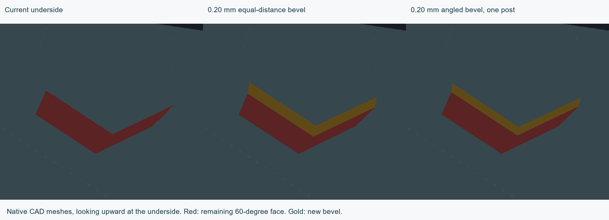
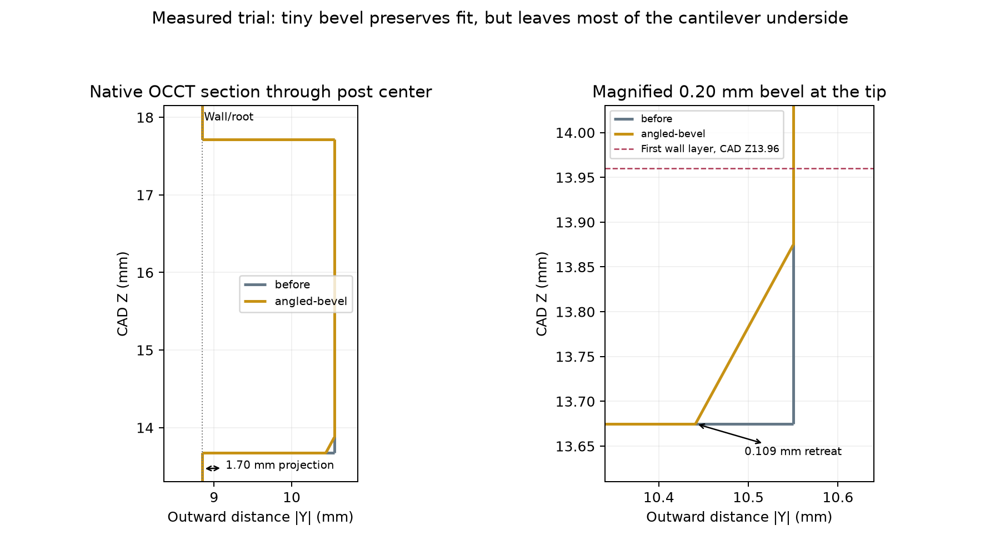
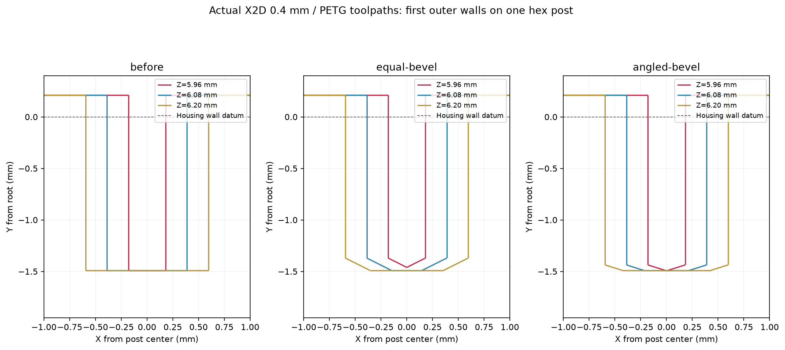

# Hex protrusion underside trials — 8 October 2026

Jeff clarified that the defect occurs on the build-plate-facing underside of the projecting hex features, rather than the previously marked A/B rims. The requested small bevel was tested against the actual saved shell print orientations. **The trials are reviewed experiments; canonical geometry and active print projects remain unchanged.** The A/B clarification is resolved.

## Measured CAD results

- A 0.20 mm equal-distance OCCT chamfer was applied to 18 downward mouth edges on each shell. Its new faces measure approximately **37.76 degrees from vertical**, and the residual undersides remain at 60 degrees. This does not meet a strict 25–30 degree limit.
- An explicit angled bevel on one lower-shell hex post measures **27.50 degrees from vertical** in the native tessellation. It has a 0.20 mm vertical setback and 0.10916 mm outward-depth setback. The original projection is 1.70 mm, so 1.59084 mm of its depth retains the original underside.
- Both trials preserve the same nominal interfering/clearance pair states. The four expected clip contact-pair overlap volumes are unchanged within numerical tolerance; the angled trial has zero recorded overlap-volume difference. Servo, bearing, hub and both clip meshes remain identical.
- Equal-distance bevels remove approximately 0.67165 mm³ from the lower shell; the one-post angled trial removes approximately 0.03821 mm³. Small volume loss and preserved CAD contacts are not printed strength or retention qualifications.

The angled cut uses ruled native lofts between triangular-prism sections, because the installed chamfer operation exposes equal-distance bevels only. This is an isolated experiment, not an application change. The section is a native OCCT intersection at X=-3.80 mm; the plotted profiles are returned section polylines. Cutaway mesh payloads are omitted from committed section records, and the originals remain in the external workspace.

## Actual Bambu toolpaths

Both experimental full-assembly projects slice successfully without warnings using the unchanged X2D / 0.4 mm / Bambu PETG Basic process. No printer job was sent. Experimental 3MF/native files remain external, clearly separate from the active project.

The selected post's first outer-wall extrusion occurs at **print Z5.96 mm** for the baseline and both trials. The baseline and angled bevel also have the same furthest outward wall centerline, **plate Y44.66 mm**. The original wall/root datum is plate Y46.15 mm, leaving approximately **1.49 mm** of outward centerline reach at the first wall layer. The tiny angled bevel changes the end-cap shape and narrows its flat segment; it does not remove that initial reach. The equal-distance bevel retreats the first tip only 0.029 mm and does not meet the requested angle. These are commanded centerlines, not swept bead envelopes, measured sag or adhesion predictions.

## Decision

Do not promote either trial as a verified cure. A tiny angled bevel is geometrically possible and preserves the nominal fit, but the slicer evidence does not establish that it prevents the reported defect. A strict 27.5 degree ramp over the entire 1.70 mm projection would require approximately **3.115 mm** of vertical relief for these diagonal hex sides; even a 30 degree ramp requires approximately 2.776 mm. That is a substantial change relative to the post's approximately 4.041 mm total height and cannot be presumed mechanically neutral. Those full-depth ramps were calculated, not applied or qualified.

The next useful experiment is support confined to the onset of these hex protrusions, or a larger underside treatment with an explicit remaining-contact and fit check. The small-bevel trials should not substitute for those checks. No additional clarification of the affected surface is needed.

## Evidence and reproduction

[Geometry/fit audit](geometry-audit.json), [actual toolpath measurements](toolpath-audit.json), [source provenance](source.json), and native slice receipts for the [equal bevel](equal-bevel-slice.json) and [angled bevel](angled-bevel-slice.json) are saved. Native CAD construction, export, slicing, section and rendering scripts are included. Reproduce against source commit **c78e2ba**; the scripts use the recorded local application paths and current.model.json from that commit. Large scenes, experimental native projects, STL/3MF files and G-code are retained at `D:/noBS-CAD-Reviews/INJS2065-Technic-Case/hex-underside-20261008`, with hashes recorded. Existing CAD validation references remain unchanged.
