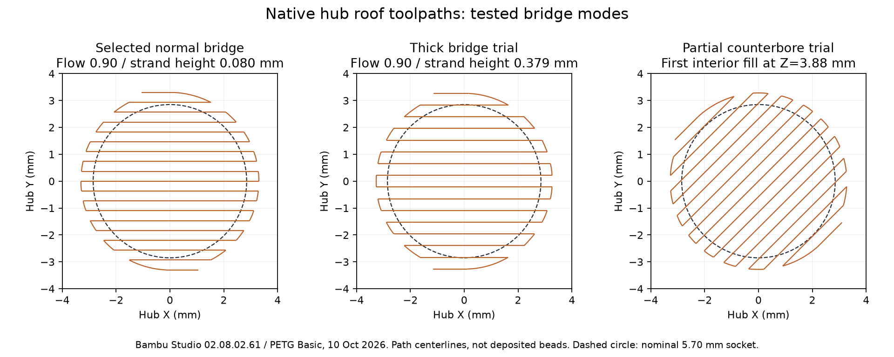
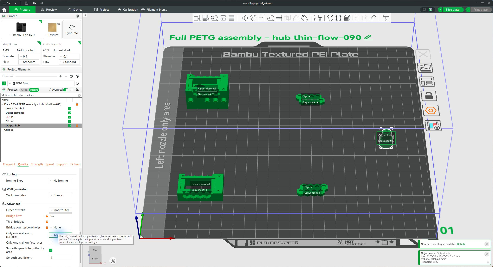

# Hub roof bridging settings — 10 October 2026

**Current geometry update:** use the [incremental fit revision and its latest complete PETG project](../incremental-fit-20261010/README.md). It retains these hub settings and mesh while changing the shells/clips. The full project in this report is the preceding 0.26 mm / beveled-post geometry.

**The updated [complete PETG project](assembly-petg-bridge-tuned.3mf) applies normal short-span bridging to the output hub only:** bridge flow **0.90**, bridge speed **25 mm/s**, thick bridges **off**, Don't support bridges **on**, counterbore bridging **None**, and hub supports **off**. Servo rim remains down, Technic cross up. No CAD dimensions, meshes, placements, other-part overrides, global process or filament settings change. Hub fine layers, six requested walls, fully solid fill and no brim remain.

This is an uncalibrated starting setting for the next print, not proof of a flat physical roof. A print was already running when Bambu Studio was inspected; these saved changes were not sent to that job. No new print was started.

## Supported Bambu Studio features

The installed executable reports **02.08.02.61**. Its matching [official setting definitions](https://github.com/bambulab/BambuStudio/blob/v02.08.02.61/src/libslic3r/PrintConfig.cpp#L1465) define bridge direction, bridge flow and **Bridge counterbore holes** with None, Partially bridged and Sacrificial layer choices. Separate [bridge/support definitions](https://github.com/bambulab/BambuStudio/blob/v02.08.02.61/src/libslic3r/PrintConfig.cpp#L1976) provide Don't support bridges, Thick bridges and Max bridge length. Dedicated bridge speed and filament overhang/bridge cooling also exist. References point to the matching release, rather than an unmerged feature request or another slicer's behavior.

Counterbore modes are intended to create a printable transition around a smaller hole above a wider recess. This hub has a **blind 5.70 mm socket with a complete roof**, so ordinary bridging is the appropriate mechanism. Testing nevertheless found that those modes affect this socket's toolpaths; merely enabling them is not harmless. A sacrificial-layer mode is not a general underside-ironing feature. Ironing is not a means of reaching this downward-facing roof.

No arc/wave-overhang control was found in this release's parameter definitions. Geometry-changing overhang repair is not applied to a friction socket. No unsupported parameter was added to the saved project.

## Native trials and selection

Four complete five-part variants were sliced using the installed Bambu Studio and the resolved Bambu PETG Basic profile. Each succeeds without warnings and without hub supports or sparse infill. [Raw native results, source version and toolpath measurements](results.json) retain the comparison. Numbers below are G-code declarations or parsed commands, not measurements of deposited plastic.

- Previous normal bridge: inherited flow **1.50**, roof at nozzle Z **3.80 mm**, declared strand height **0.120 mm**, 33 bridge extrusion commands, **1.82001 mm** of filament extruded for hub bridge features.
- Selected normal bridge: flow **0.90**, roof at the same Z **3.80 mm**, declared strand height approximately **0.080 mm**, 37 bridge extrusion commands, **1.21149 mm** of filament. Actual bridge commands run at **25 mm/s**. This removes the unusually high inherited flow; it does not establish a calibrated optimum. Bridge-feature filament extrusion drops about **33.4%**, not 40%, because the generated path spacing/count also changes.
- Thick bridge at flow 0.90: roof remains at Z **3.80 mm**, but declared strand height is **0.379473 mm** and extrusion rises to **4.06637 mm** of filament. Its much thicker strand creates a concern about downward intrusion/sag and usable friction-socket depth. That is a geometric screening concern, not a measured depth loss. It is not selected for this short span.
- Partially bridged counterbore: no hub Bridge extrusion commands remain. First sampled material across the socket interior occurs at Z **3.88 mm**, classified as Internal solid infill. This drops the expected first roof bridge and is rejected here.
- Sacrificial-layer counterbore: roof bridge remains at Z **3.80 mm**, declared height **0.120 mm**, 37 extrusion commands, **2.21878 mm** of filament. It changes fill without a demonstrated benefit for this already closed roof, so it is not selected.

The selected complete plate estimates **2 h 21 min 25 s / 22.73 g**. This tuning saves negligible time/mass; its purpose is to control roof extrusion. The large support/time saving came from the preceding orientation change.

All bridge variants with Bridge commands emit part-fan command **M106 S150.45**, approximately **59%** of the 255 command range, at their roof. The saved PETG profile requests 50% overhang fan; its layer cooling raises the effective command here. Cooling is already active and is preserved. No global cooling change is made that would affect the clips or shells. A fan command is not a measured airflow or fan RPM.

## Validation limits

The package comparison reverses the declared hub overrides and plate label, then verifies the entire object-settings tree against its source. All other ZIP payloads are byte-identical, including every mesh, global settings and placement matrices. Canonical CAD still hashes to `19a73dd1a82072cfbd80a95da27a19720c7a09fef52b39dab940d3c3ec4ec340`.

The strengthened toolpath parser samples straight extrusion segments at up to 0.04 mm spacing and samples arcs, rather than inspecting only straight-segment endpoints. Conservative servo-interior checks below Z=3.40 mm have zero sampled model hits in all trials. This checks model paths, not the full bead envelope, bridge sag or printed friction. Actual roofs still need inspection for strand separation/sag, followed by full servo seating and friction retention. The [detent mechanics and qualification limits](../print-decision-20261009/README.md) remain unchanged.

`test_bridge.py` reproduces the native trials locally. It reuses the previous recorded path parser without running the preceding slicing workflow, strengthens it for straight segments, and records feed/fan commands. Native logs and G-code are in `D:/noBS-CAD-Reviews/INJS2065-Technic-Case/hub-bridge-20261010`. The official source commit used is `926a7192574bcb9b3a732e1ec59a46d79cb45466`; source files are referenced, not copied into this design repository.

## GUI verification

The tuned project was opened in a separate Bambu Studio window. Selecting **Output hub → Quality → Advanced** visibly shows **Bridge flow 0.9**, **Thick bridges unchecked**, and **Bridge counterbore holes None** as object overrides. The saved project also retains explicit plate-level print by object. Live nozzle/AMS synchronization was deferred while slicing with the reviewed saved profile.

The fresh GUI slice completed and confirms **22.73 g / 2 h 21 min** (rounded); the separate project was left in Preview.

[Completed GUI Preview](bambu-preview.png). Run `render.py` to regenerate the inspected native toolpath figure from the saved external G-code without repeating slicing.
