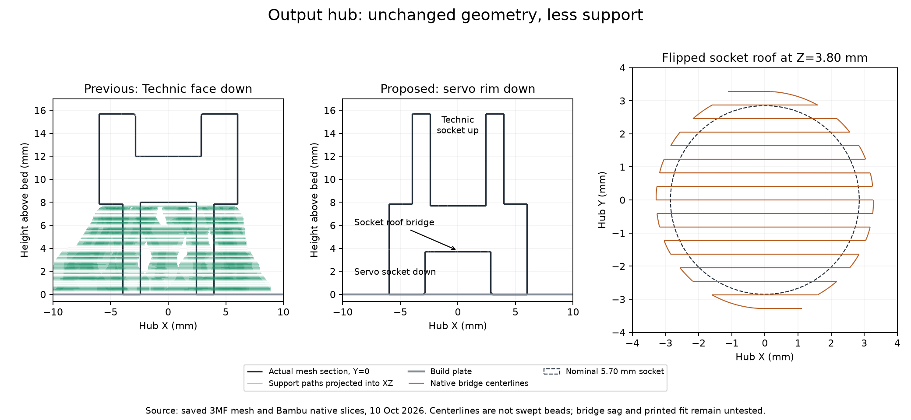
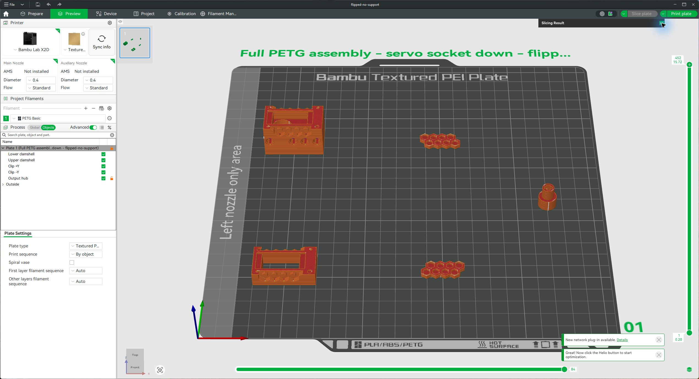

# Output hub orientation — 10 October 2026

**Use the large servo socket rim down, with the Technic cross socket up and hub supports disabled.** [Updated complete five-part PETG project](flipped-no-support.3mf). This is a printing experiment pending Jeff's final go/no-go; no job was sent. The clip retention and strain limitations in the [print-decision report](../print-decision-20261009/README.md) remain.

The original orientation prints the narrow Technic end down and requires supports under the larger shoulder. Flipping the hub provides a wider annular footprint, removes that unsupported shoulder, and leaves a short bridge over the **5.70 mm diameter, 3.70 mm deep** servo socket. Native bridge paths occur at Z=3.80 mm. The Technic cross now opens upwards.

## Native comparison

- Previous orientation: **2 h 29 min 33 s / 23.11 g** for the complete plate; hub support/interface extrusion uses **124.76578 mm of filament**.
- Flipped, automatic supports retained: approximately **2 h 21 min 36 s / 22.76 g**; hub supports use **9.17367 mm of filament**, a 92.65% reduction. However, **495 support extrusion segments have sampled centerlines inside the servo socket interior**. This is avoidable cleanup inside a friction interface.
- Flipped, hub supports disabled: approximately **2 h 21 min 25 s / 22.74 g**, **zero hub supports**. Savings against the preceding plate are approximately **8 min 7 s and 0.38 g**. Both flipped native slices succeed with five objects and no warnings.

Mass and time are full-plate slicer estimates. Support numbers are extruded filament length, not deposited path length or grams. Small timing differences between native runs are recorded in [comparison.json](comparison.json).

## Preserved settings and checks

Only the hub placement (180° about X plus a height translation), its support enable override, and plate label change. Every mesh payload, global project settings, other four placements and object configurations remain byte-identical to the preceding prepared project. The whole object-settings tree is compared after reversing the allowed edits. Canonical CAD is unchanged; this does not update the CAD's saved print-layout named view.

The hub retains **0.08 mm layers, six requested walls, fully solid material, slower walls and no brim**. Bambu X2D / 0.4 mm / Bambu PETG Basic and plate-level **print by object** are preserved. Native toolpaths have no hub sparse infill and no sampled model centerlines crossing the conservative socket-interior checks. These checks exclude walls and floors and do not prove swept-bead clearance or printed dimensional accuracy. The automatic-support variant is retained for comparison, not as the preferred print.

The servo mouth now touches the textured plate. Its existing 0.15 mm entry chamfer is unchanged; first-layer expansion or texture could tighten the friction fit. PETG bridge sag could reduce seating depth at the roof. Inspect the bore mouth and roof, then verify full insertion and friction retention before using the hub. No material correction, socket resizing, new chamfer, bridge-profile change or additional compensation was made without printed evidence. Turning the part over does not qualify its torque capacity or change the unresolved detent mechanics.

## Bambu Studio check

The preferred five-part project was opened and freshly sliced in Bambu Studio, then left in Line Type Preview. The GUI shows X2D, 0.4 mm, PETG Basic, **By object**, **22.74 g / 2 h 21 min** (rounded), with no support entries in the line-type summary. The nozzle/AMS synchronization prompt was deferred to retain the reviewed saved configuration; live hardware synchronization remains unverified. No print job was sent.

[GUI time and material summary](bambu-estimate.png).

## Reproduction

Run `compare.py` with the existing local Python interpreter. It uses native Bambu Studio, the saved resolved PETG Basic profile and the preceding `assembly-petg-review.3mf`. Native logs and G-code stay in `D:/noBS-CAD-Reviews/INJS2065-Technic-Case/hub-orientation-20261010`; projects, audit and figure are saved here. The section figure uses the previously installed local NumPy/Matplotlib dependencies. No software installation or printer transmission is performed.
