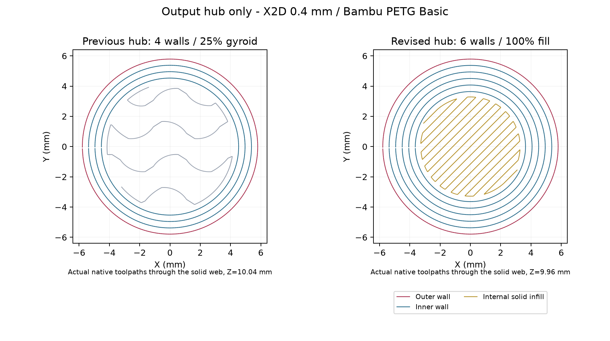

# Output hub strength and quality profile - 8 October 2026

[Complete PETG assembly project](assembly-petg-hub-quality.3mf), Bambu Studio 2.8.2.61, X2D / 0.4 mm nozzle, Bambu PETG Basic. Canonical CAD and all socket dimensions remain unchanged.

Only Output hub (object 105) receives six requested wall loops, fully solid fill, 0.08 mm main layers, a 30 mm/s outer-wall limit, 60 mm/s inner-wall limit and 30 mm/s top-surface limit. First layer remains 0.20 mm. Internal fill limits are 90 mm/s. Existing hub supports and orientation remain. Shells and clips retain 0.12 mm / four walls / 25% gyroid.

The two sockets have a 4.00 mm solid separator. Servo radial wall is 3.15 mm along the bore and 3.00 mm at the chamfer mouth. Confirmed Technic cross stock is 1.37457 mm minimum at its corners. Six loops fit the wide hub section; fewer fit that narrow stock. No obvious thin separator exists around the servo bore. Physical torque and axial retention remain unqualified.

## Verification and reproducibility

The initial 100% density override still generated open infill. Bambu's serialized Rectilinear pattern key is `zig-zag`; `rectilinear` substituted another pattern. Even after correcting that key, this CLI workflow did not produce fully dense fill from density overrides alone. Hub-only top/bottom shell thickness is therefore intentionally 16 mm, exceeding its 15.70 mm printed height, to force a fully solid interior. Recheck if the hub geometry grows. The final toolpaths contain zero hub Sparse infill segments, dense Internal solid infill and six radial wall bands at Z=9.96 mm. The illustration shows path centerlines, not bead widths or bond strength.

Native slicing succeeded without warnings and recognized all five meshes and bounds. Extrusion Z levels verify 0.08 mm hub layers and unchanged layer levels for the other parts. Other-part filament totals change by less than 0.1 mm each. Lower shell and clips retain identical coordinate/feature signatures. Upper-shell paths have incidental sequencing/segmentation differences recorded in the audit; configuration, geometry and layer levels remain unchanged. Global settings and geometry ZIP entries are byte-identical to the previous project; only the hub configuration changes.

No sampled path enters the central servo socket above its floor: radius below 2.55 mm, printed Z12.2-15.55 mm, excluding 0.30 mm near the wall. This is not a swept-bead or physical-fit proof. Supports remain confined to the hub region. Cooling slows actual outer-wall commands below the requested limit. Full-plate estimate is about 2h51m; see the native record for filament consumption. No printer job sent. This remains a physical fit/strength-test candidate.

[Spacing](spacing.json), [isolated changes](project-change.json), [native slice](native-slice.json), [toolpath audit](toolpath-audit.json), [previous CAD evidence](../hub-friction-20261007/README.md).

`prepare.py`, `slice.py` and `audit.py` use recorded local source paths and the external review environment. Native G-code remains outside Git at `D:/noBS-CAD-Reviews/INJS2065-Technic-Case/hub-quality-20261008/slice-final/plate_1.gcode`, with its SHA-256 in the slice/audit records. Python rendering dependencies remain in the earlier external slicer-review environment. [Official Bambu configuration source](https://github.com/bambulab/BambuStudio/blob/master/src/libslic3r/PrintConfig.cpp) is linked for serialized pattern names; no source code is copied into this repository.
