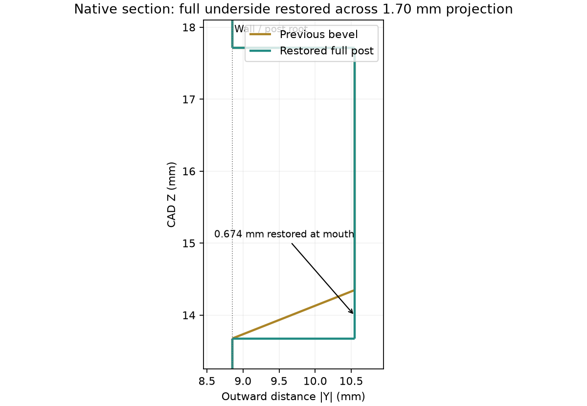
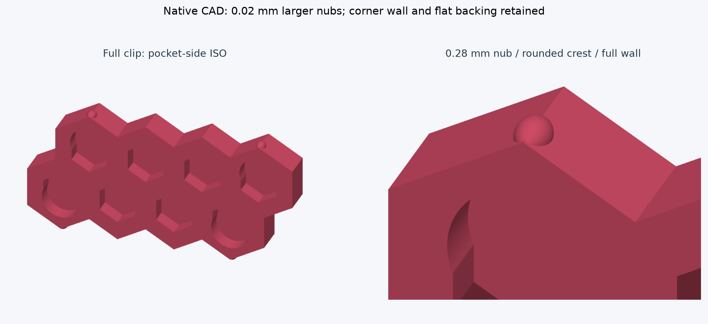
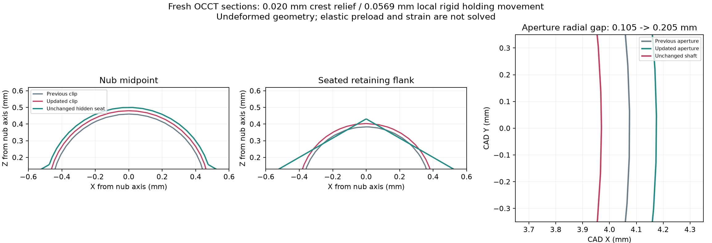

# Incremental fit revision — 10 October 2026

The current CAD removes the underside bevel from all 16 housing hex posts, increases the four centered detent nubs on each clip from **0.26 to 0.28 mm**, and opens the stationary shaft aperture from **Ø8.15 to Ø8.35 mm**. These are incremental responses to Jeff's printed observations. Geometry and native slicing pass; a successful physical snap and free-rotation test are still required.

[Current complete PETG project](assembly-petg-incremental-fit.3mf). [Registered complete-shell fit project](registered-receivers.3mf) uses the same two shells and clips without the hub. Neither file starts a print. The existing modified `review/hub-orientation-20261010/flipped-no-support.3mf` was left untouched and is not the source of this revision.

## Restored hex posts

The complete terminal bevel subtree, feature IDs 786–801, is removed from the native history and matching definitions. It existed solely to create and consume the 16 underside cutters; no earlier feature/body IDs were renumbered. History decreases from 390 to **374 valid features**, with seven bodies. Full underside material is restored across each post's **1.70 mm projection**, including approximately **0.674 mm** at its mouth. Original root geometry and locating surfaces return. This also returns the original abrupt overhang; the failed printing experiment is not replaced by another untested bevel.

## Incremental detent selection

The selected nub grows by **0.02 mm**, about 7.7%. It retains its confirmed midpoint, symmetric rounded lead-in/out and **R0.80 crest**. Tangent outer blends are **R0.20**, and its meridian span grows from 1.440 to **1.4664 mm**. Full clip walls, all eight blind hex pockets, approximately **0.898 mm** corner walls, **1.45 mm** flat backing, and **0.10 mm per-flat** inner locating gaps remain. Native sections confirm the backing is unchanged. The hidden receiving seats and visible housing hex mouths are unchanged by detent tuning.

The selected crest retains **0.020 mm nominal radial clearance** at the seat center. Local rigid-envelope holding movement becomes **0.05693 mm**, previously 0.020 mm. This is a geometric clearance construction, not a solved elastic displacement, preload force or strain. Contact remains on diagonal flanks. An unrelieved flank crossing the crest gives approximately **0.39933 mm** axial envelope movement, compared with 0.36241 mm previously; this is not a simulated peak insertion deformation. Larger detents increase both retaining margin and the demand on the backed frame.

Three candidates were built and sliced using the same X2D / 0.4 mm / Bambu PETG Basic configuration. All 24 paired native-toolpath samples have nominal contact for each candidate. The existing sensitivity method erodes the commanded-width material envelope on each mating surface. Its distances are hypothetical surface setbacks, not measured printer accuracy, PETG shrinkage or statistical tolerance bounds.

- **Selected 0.28 mm nub, existing R0.50 seat:** no lost samples at 0.02 mm setback per surface; four of 24 lose contact at 0.03 mm; 19 at 0.04 mm; all at 0.05 mm. The prior 0.26 mm design lost 13 samples at 0.03 mm and all at 0.04 mm.
- **0.30 mm nub, existing seat:** retains all 24 samples at 0.03 mm, but has **zero nominal center crest clearance** and 0.08979 mm local holding movement. Rejected as the default; the stronger nominal screen does not establish acceptable insertion or strain.
- **0.30 mm nub, R0.52 relieved seat:** restores 0.020 mm center clearance and reduces local holding movement to 0.06043 mm, but loses eight samples at 0.03 mm. It performs worse than the smaller increment at that sensitivity level. It is not selected.

The selected increment improves the prior sampled margin while preserving center relief and making a smaller demand on the clip. It does **not** guarantee retention across an unknown physical tolerance range. The nozzle diameter is not an XY positioning increment: the relevant evidence is the actual sliced contour, bead width and layer phase. The native toolpaths differ after this 0.02 mm change. No uncalibrated global contour/hole compensation or filament-flow change was added.

## Rotary clearance

The through-aperture in the upper housing opens by **0.20 mm in diameter**, giving **0.205 mm radial clearance** around the unchanged **Ø7.94 mm journal**, previously 0.105 mm. Only this stationary aperture changes. The **Ø8.00 mm bearing bore**, **0.030 mm journal-to-bearing radial gap**, bearing support/seat, hub shoulders, and axial geometry remain unchanged so bearing centering is preserved.

The complete upper-housing/hub minimum clearance is **0.150 mm**, rather than 0.205 mm: a different existing surface becomes the closest pair. The aperture-specific radial gap and overall body minimum are different measurements. Other existing bearing/housing and flange clearances still require checking on the printed assembly; this change does not loosen the bearing fit.

The native **Z = 40 mm** section leaves approximately **4.614 mm** between the enlarged aperture and its nearest other section boundary, previously 4.714 mm. This checks remaining material in that section; it is not a global wall minimum or a strength calculation. [Final dimensional and native-payload check](final-check.json).

The hub mesh is exactly preserved: garden-auger **Ø5.70 × 3.70 mm** friction socket, previously confirmed Technic cross (**4.85 mm span, 1.85 mm arms, 8 mm depth**) and **3.8 mm separating web** are unchanged. Hub-only six requested walls, solid fill, 0.08 mm main layers and support-free 0.90-flow/25 mm/s thin roof bridging remain.

## Validation and printing limits

- Fresh native replay passes **374 features / seven bodies / zero errors**. Servo, bearing and hub meshes remain exactly identical; assembly poses and named views are preserved. Only four intended clip/housing pairs intersect in the rigid installed assembly; no new pair appears. This does not solve elastic contact.
- Both full-project candidates and the relieved trial slice successfully without native warnings. The selected five-part project estimates **2 h 21 min 18 s / 22.77 g**. The updated registered four-part test estimates **1 h 46 min 6 s / 21.54 g** and preserves complete shell locators.
- The selected and relieved project's ten exported meshes pass closure, connectivity and positive-volume checks. This mesh audit does not check all possible self-intersections. Native toolpaths contain no support or brim; both clips and the hub slice solid. Hub thin-bridge settings are confirmed in the generated G-code.
- Printed snap, insertion/removal force, elastic strain, creep and endurance remain unqualified. Earlier overconstrained strain/force estimates remain withdrawn. No replacement structural solve was accepted or executed for this revision. Full backing makes a free-cantilever formula inappropriate as qualification.

**Next physical acceptance:** assemble the complete registered shells; confirm full clip seating, perceptible snap, retained seam without hand restraint, no wobble or free sliding, and no whitening or permanent set. Verify the larger aperture permits rotation without housing rubbing while the bearing still locates the shaft. Repeat insertion/removal and seated dwell. If the nub is still ineffective, record the printed nub/seat dimensions and fit response before selecting another increment. Do not substitute the older cropped or 0.26 mm test files for this revision.

## Evidence and reproduction

[Decision and trial metrics](decision.json), [selected native audit](nub-28-audit.json), [selected paired toolpath screen](nub-28-all-corners.json), [selected slice receipt](nub-28-slice.json), [toolpath audit](toolpath-audit.json), [mesh audit](mesh-audit.json), [registered-project audit](registered-receivers-audit.json), and [new regression reference](../incremental-fit.json) retain the results. The new reference is candidate-generated and checks repeatability, not independently approved mechanics. Existing historical references are not rewritten. Run `node tools/verify-current.mjs` for the current native replay.

Canonical native archive and JSON payloads match. Input is the canonical model at source commit **3dd035e9c8deb0c4142c0fe4cdfbcc9a31723f6c**, SHA-256 `19a73dd1a82072cfbd80a95da27a19720c7a09fef52b39dab940d3c3ec4ec340`. Recover that source in an isolated checkout before replaying these historical build scripts. `prepare-source.mjs` removes the explicit terminal subtree and edits the aperture; `build-trials.mjs` and `build-relieved.mjs` reuse native sketch/revolve edits and fillet repair; `slice-trials.py` preserves all profile/placement overrides from the preceding bridge-tuned project. `screen-trials.py`, `audit.mjs`, `render.py`, `registered.py`, `toolpaths.py` and `finalize.py` record evaluation and saving. Scripts retain explicit local investigation paths; they are not portable app features.

Large native scenes, source backups, fine STLs, intermediate models and G-code remain at `D:/noBS-CAD-Reviews/INJS2065-Technic-Case/incremental-fit-20261010`. Figures display actual undeformed native geometry and OCCT sections. No printer job was sent or existing Bambu project overwritten.

Relevant Bambu setting definitions are referenced from the [matching installed-version source](https://github.com/bambulab/BambuStudio/blob/v02.08.02.61/src/libslic3r/PrintConfig.cpp). Local measured CAD and native slice receipts, rather than a universal vendor tolerance claim, support the dimensional decisions above.
