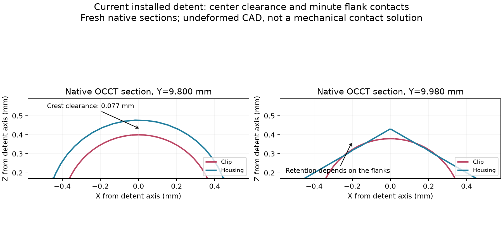
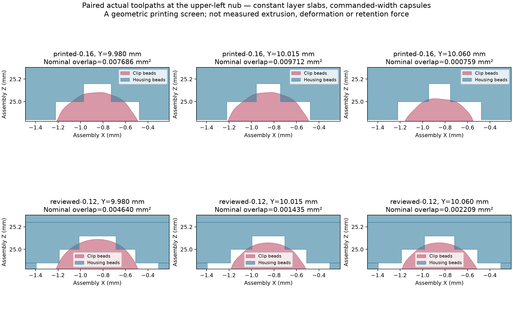

# Printed clip retention failure - 9 October 2026

**Current status: the printed clips failed the functional fit test. Do not treat the current assembly as a working retaining design or recommend another full-assembly print without correcting and testing the fit.** No CAD geometry, print settings or validation references were changed in this investigation.

Jeff reports that the clips slide in without a snap, wobble when installed and have no friction. This is consistent with loss of detent engagement, exposing the ordinary hex locating clearance. It does not identify a measured dimensional error, material deformation or creep mechanism by itself.

## Source and job identification

Canonical source is commit `764cfa9`, model SHA-256 `27cb737aa9b6fb2b244dc68c8676469a55dc2f78c0f57a72a2992f2489ac4b46`. The printer Device screen showed the finished job `INJS2065_PETG_print_set_-_friction_hub`, 452 layers, 2 h 26 min 53 s and 23.83 g. The old job title is inherited metadata, not evidence of old geometry.

The local Bambu cache points to `review/flat-clip-base-20261008/assembly-petg-flat-clip-base.3mf`. All five cached meshes match that current project after recentering, with maximum vertex differences approximately 0.000001 mm. The printer's stored package was not independently downloaded, so this establishes consistency of the local job/cache and observed job statistics, not a byte-for-byte retrieval from the printer. [Job audit](printed-job-audit.json).

The cached job used X2D / 0.4 mm and Bambu PETG Basic. Main layers were **0.16 mm**, compared with 0.12 mm in the preceding reviewed export; the hub retained 0.08 mm. Four requested walls, 25% gyroid, Classic walls, flow ratio 0.95, XY contour/hole compensation zero and shrink settings 100% were recorded. The narrow clip walls already slice solid. Adding infill or requested wall loops alone does not create a missing retaining contact. Cached G-code SHA-256: `023d710cc771334558ef07080b2e955736ecf20f662890f5854cc632da58e78b`.

## Geometry explaining the weakness

The first hex profiles in canonical sketches 320, 348, 474 and 518 give the following half-widths across flats: housing outer recess 3.75 mm; clip outer envelope 3.55 mm; housing inner post 1.75 mm; clip pocket 1.95 mm. Both nesting interfaces therefore have **0.20 mm clearance per mating flat**, or 0.40 mm difference across opposed flats. These are native nominal dimensions, not measured printed free play.

The nub protrudes 0.20 mm, but protrusion is not installed preload. Its center has **0.07697 mm radial clearance** inside the hidden receiver. Intended holding depends on two minute diagonal flank contacts. The prior exact envelope calculation gives **0.022571 mm inward clearance movement**, not a solved elastic preload or withdrawal force. Exact CAD overlap remains only approximately **0.00002936 mm3 per housing/clip pair**. See the [earlier derivation](../revision-20261007/REVIEW.md).

These are actual native sections through the current assembly, not a deformed illustration. The center gap is intentional; it becomes problematic because the remaining retaining contacts have too little margin. A center-only image misses those contacts.

The last floor correction restored backing from 1.00 to 1.45 mm, while leaving the nub geometry, six relevant wall sections and nominal assembly contacts unchanged. It may affect flex stiffness, but it did not enlarge the geometric fit clearances. The preceding root bevel reduced some post bearing height; it also preserved the mating flat spacing and nominal detent contacts. Neither change independently explains a measured dimensional miss without inspecting the printed pair.

## Paired toolpath screen

The printed clip nubs survive in the cached toolpaths. At the layer covering the receiver flank boundary, the clip-only nominal bead support extends only **0.0041-0.0078 mm** beyond the unsliced housing flank planes at the four corners of clip +Y. The reviewed 0.12 mm case gives approximately 0.0107-0.0137 mm. This clip-only calculation is not a paired printed contact calculation.

Both mating toolpaths were then included. Commanded-width bead capsules were extruded as constant layer slabs and intersected in native assembly coordinates. The actual lower shell's 180-degree rotation about Z and both opposite clip orientations were included. All eight nub locations were sampled at |Y| = 9.980, 10.015 and 10.060 mm, for **24 sections**. [All-corner results](all-corners.json), [clip-only results](nub-toolpaths.json).

Nominal overlap remains in all 24 sampled printed sections, ranging from 0.000273 to 0.010066 mm2 in the local regions. Thus the slicer did not simply delete every nub, and the 0.16 mm setting alone is not established as the cause. At the upper-left nub, 0.16 mm has more overlap than 0.12 mm at two sampled planes and less at the third. [Paired comparison](paired-toolpaths.json).

As a sensitivity example, eroding **each** mating material envelope by **0.03 mm** eliminates overlap in every sampled section of the actual print. This is **not a measured print error, PETG shrinkage estimate, complete clearance bound or tolerance specification**. It shows that modest departures from the nominal bead geometry can defeat the intended contact. Other sections may behave differently; this is not a full 3D insertion/contact solve. Actual extrusion shape, flow, seams, deformation, shrinkage and creep were not measured.

## Replay check and limitations

The canonical bytes are unchanged. Fresh native replay yields 390 successful features, seven bodies, no native errors, all topology signatures matching, and the exact recorded assembly interference pairs matching. Six of the seven body mesh hashes match the saved reference, including both clips. [Replay audit](replay-audit.json).

**The strict `node tools/verify-current.mjs` check fails on body 18's mesh hash under the presently installed CAD executable.** The upper shell's export differs from the prior reference while its topology and exact assembly pairs match. Comparing the old and new mesh finds 848 triangles different at 0.000001 mm coordinate rounding; unmatched vertices are within approximately 0.000100 mm of the other mesh's vertices. Per-index vertex differences reflect ordering and must not be interpreted as millimeters of shape motion. This nearest-vertex check does not prove complete surface equivalence. The mismatch remains recorded; no golden reference was rewritten. [Mesh discrepancy](mesh-discrepancy.json).

The source/job matches and nominal contact sensitivity support a design-margin diagnosis. Physical measurements are still needed to distinguish printed dimensional clearance, a seating/pose issue or deformation. Prior prescribed-displacement FEM reactions and unconverged strain peaks do not establish actual retaining force, peak insertion strain or current backing safety.

## Recommendation before further geometry changes

1. Retune the locating flats, rounded nub and hidden receiver **together**. Define a holding contact with an explicit dimensional tolerance budget rather than relying on microscopic flank overlap. Preserve full walls, centered nubs and the visible hex-mouth appearance.
2. Keep minor installed preload, but separately establish the insertion capture/travel and withdrawal obstruction. A larger nub by itself can increase insertion strain in this continuously backed frame; do not select its size from protrusion alone.
3. Measure this printed clip/receiver pair and run a small parameterized mating coupon with the actual Bambu PETG Basic, nozzle, orientation and profile. Check snap, rattle, insertion/removal force and retention after dwell before another full assembly.
4. Recompute travel/contact and strain for the chosen geometry, and resolve the strict replay mismatch before issuing another readiness statement.

The earlier CAD and slice checks established reproducible source geometry and toolpath generation; they did not establish a reliable retaining fit. The physical result supersedes their recommendation to try this fit candidate.

## Reproduction and evidence

The included scripts are local investigation evidence with explicit Windows paths, not portable application code. `native-sections.mjs` generates native sections; `native-plot.py` plots them. `inspect-paths.py` uses the existing G-code parser to save paths and clip-only flank support. `paired-toolpaths.py` and `all-corners.py` screen the commanded bead envelopes; the latter uses Shapely 2.1.2. `replay-audit.mjs` records native replay without updating any reference.

Large path dumps, full replay scene, original G-code and installed analysis dependencies remain in `D:/noBS-CAD-Reviews/INJS2065-Technic-Case/loose-fit-20261009`. The printed job cache was `C:/Users/jeffg/AppData/Local/Temp/bamboo_model/Thu_Oct_08/08_54_00#7056#69`. Compact results, plots, native section receipts and scripts are versioned here. No printer job was started during the investigation.
