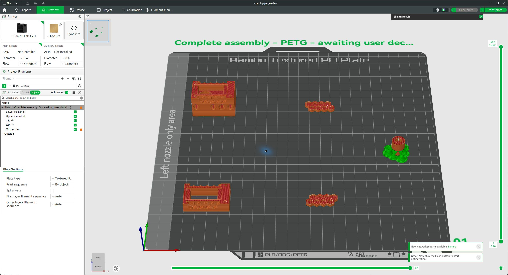
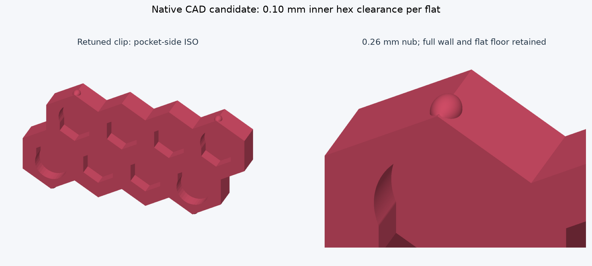
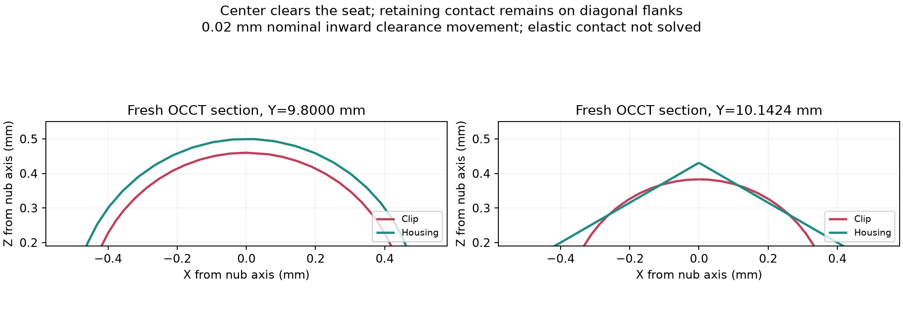

# INJS2065 PETG print decision

**Latest bridge update:** [Current complete project and hub-only short-span bridge settings](../hub-bridge-20261010/README.md) retain the flipped hub and apply bridge flow 0.90. Four native trials compare normal/thick bridging and both dedicated counterbore modes. Estimate 2 h 21 min 25 s / 22.73 g. This is for the next slice; it was not transmitted to the print observed running in Bambu Studio.

**10 October orientation update:** The [latest full PETG project and native comparison](../hub-orientation-20261010/README.md) flip only the hub, servo rim down, with hub supports off. It estimates 2 h 21 min 25 s / 22.74 g. All CAD meshes and the other four parts/settings remain unchanged. The full plate and GUI capture below document the preceding orientation; use the linked update for the current full prototype. The registered fit project and mechanical limitations remain current.

Prepared for Jeff's final go/no-go. **My recommendation is GO for a controlled fit experiment; defer functional qualification until that test passes.** The complete assembly is also prepared if Jeff chooses to print all five parts as a prototype. Neither choice establishes retention strength or service life. No print job has been sent.

## What is ready

- [Complete five-part assembly](assembly-petg-review.3mf): lower shell, upper shell, both actual clips and output hub. Fresh native slicing passes without warnings; estimate **2 h 29 min 33 s / 23.11 g**. Servo and bearing are purchased reference hardware, not printed parts.
- [Registered fit test](../contact-fix-20261009/registered-receivers.3mf): complete lower and upper shells with their original locators and both nominal clips. Meshes and transforms independently checked; fresh native slicing passes without warnings; estimate **1 h 46 min 13 s / 21.50 g**. This replaces the cropped coupon.
- [Package audit](package-audit.json): mesh payloads, placement transforms, object overrides and embedded project settings exactly match the reviewed full candidate. Project/plate names, serialization and an explicit plate-level `by object` override changed. Canonical geometry remains revision 613402c, SHA-256 `19a73dd1a82072cfbd80a95da27a19720c7a09fef52b39dab940d3c3ec4ec340`.

The fit test saves about 43 minutes but only 1.61 g; the full prototype adds the output hub. Its additional time is largely the hub's small layers and solid print. Either option uses the same nominal clip and complete receiver geometry.

## Bambu Studio GUI check

The complete five-part project was opened and sliced in Bambu Studio, then left in Line Type Preview. The GUI confirms X2D, 0.4 mm, PETG Basic, **By object**, **23.11 g / 2 h 30 min** (rounded). The GUI caught and prompted correction of an invalid slash in the plate label and a missing plate-level print-sequence override. Both prepared projects now explicitly save `by object` at plate level; all original meshes and placements remain unchanged. The GUI prompted for nozzle/AMS synchronization; this review used the saved configuration and did not establish the printer's live hardware configuration. No print was sent.

## Actual print settings and modifiers

Both projects use **Bambu X2D / 0.4 mm nozzle / Bambu PETG Basic**, print by object and the reviewed spaced placements. Main shells/clips use 0.16 mm layers, a 0.20 mm first layer, four requested walls and 25% gyroid. Embedded temperatures are 245 C first layer / 250 C thereafter, with the configured textured-plate bed at 70 C. These values match the resolved PETG profile used by the native slice.

The **hub alone** has 0.08 mm layers, six walls, 100% infill, slower walls/surfaces and build-plate-only automatic tree supports. Its 16 mm top/bottom thickness settings further make this small hub solid. The hub has no brim. The shells and clips have no supports or brims, and **no regional clip modifiers are currently configured**. Narrow clip sections already slice solid; four requested walls does not mean four physical loops can fit through a roughly 0.90 mm wall. More requested walls or infill alone cannot increase that wall's thickness.

The 3MF remains an editable project. Re-slice in Bambu Studio after any profile, plate, orientation or object-setting change. Use the current Basic filament rather than substituting PETG HF. Physical drying, actual build plate, nozzle condition and filament calibration must match the printer being used; those machine conditions have not been measured by this review.

## Clip, nub and receiving pocket

The clips retain full continuous walls, eight blind hex pockets each, four centered symmetric rounded nubs each, and pocket-side corner thinning. Minimum in-plane relief wall is approximately **0.898 mm**; backing is **1.45 mm**. Nub protrusion is **0.26 mm**, with a **0.80 mm** meridian crest radius and approximately **0.214 mm** outer blends. The visible housing mouths remain unchanged; receiving relief is hidden inside.

Inner locating clearance is **0.10 mm per flat**. The receiving-seat construction targets **0.020 mm local inward rigid-envelope holding movement**. This is a geometric target, **not a measured preload distance or an accepted elastic displacement**. Intended insertion flex is inward toward the pocket, perpendicular to the broad clip face. Actual inward bending through the insertion path has not yet been demonstrated.

The servo hub preserves the reviewed direct-to-shaft friction socket, **diameter 5.70 mm x depth 3.70 mm**, with a 0.15 mm entry chamfer and no accidental horn tabs. The other side retains the previously confirmed Technic cross: **4.85 mm span, 1.85 mm arms, 8.0 mm depth**, with **3.8 mm** material between the two socket floors. These retained dimensions are not new fit qualification. [Hub change audit](../hub-friction-fit.json), [native socket sections and toolpath inspection](../assembly-print-20261007/README.md).

## What passed, and what remains uncertain

Native replay at the current canonical hash passes **390 features, seven body meshes/topologies, three preserved bodies and expected assembly contacts, with no native errors**. It is a regression check against a candidate-generated baseline, not independent mechanical acceptance. The expected nominal housing/clip contacts remain; they are not automatically defects to remove. Original visible mouths and complete backing were separately checked for preservation.

Paired full-assembly toolpaths retain nominal contact in all **24 sampled corner sections**. A hypothetical **0.03 mm surface setback on each mating part removes contact in 13 of 24 samples; 0.04 mm removes it in all 24**. This shows limited retention margin. It is a sensitivity construction, not measured printer error, a probability of success, or a contact-force prediction. The earlier physical print sliding in without snap/friction and wobbling is still the strongest evidence that physical testing matters. [Toolpath sensitivity receipt](../retention-fit-20261009/all-corners.json).

The old strain model fixed unsupported pocket-floor material, so its forces and strains are withdrawn. The corrected experiment fixes no floor nodes and permits opening frictionless contact against the actual native-exported receivers. Two sampled-converged trial states failed full deformed-solid intersection checks. The final refinement hit its 300-second QP limit and returned `solved inaccurate`, which was rejected. **No accepted static preload/holding force or strain is available. No solved insertion displacement, dynamic insertion strain, pull-off force, creep or fatigue estimate is available.** The 0.362407 mm single-meridian construction is not an insertion-deflection prediction. PLA is not qualified. [Adversarial findings](../adversarial-retention-20261009/README.md), [corrected experiment and failure evidence](../contact-fix-20261009/README.md).

## Acceptance check after printing

1. Inspect both clips: complete walls and nubs, no separated first-layer edges, missing bead regions, cracks, or support remnants at mating surfaces. Photograph each clip and its plate label.
2. Fully engage both complete shells' original locators. Lightly restrain the exterior Z faces only, leaving the Y clip-installation faces accessible. Verify the seam is seated and the restraint does not distort the housing. Do not squeeze the clip faces to manufacture friction.
3. Insert each clip separately. Confirm it seats completely, observe whether flex is inward toward the pocket, and record snap, rocking and pull-off resistance. Stop rather than forcing an obstructed clip.
4. Release the external restraint. Both clips must hold the shell seam closed without perceptible loose rocking or sliding. Record behavior with and without restraint so fixture friction is not mistaken for retention.
5. Remove and inspect for whitening, cracks or permanent set. Repeat several installation/removal cycles and a seated dwell; record counts, dwell duration and changed fit. This is a practical prototype screen, not a validated cycle-life test. For a full prototype also check the servo friction socket and Technic axle fit after removing hub supports.

**A repeat of the previous slide-in/wobble behavior is NO-GO. Incomplete seating, permanent set, cracking, or dependence on external restraint is also NO-GO.** A clean repeatable snap with full seating and retained seam supports proceeding to further measured testing. Quantitative load acceptance still needs the intended service loads, force/displacement measurement and multiple specimens; there is no invented numeric pull-off threshold here.

## Decision left to Jeff

- **GO: controlled fit experiment** — print the registered shells and nominal clips to directly resolve fit, inward flex and retained seating.
- **GO: complete prototype** — print the prepared full plate while accepting that clip retention and hub friction remain unqualified until inspected and tested.
- **NO-GO: hold printing** — keep this package and report as the review checkpoint while resolving the contact experiment or obtaining other evidence.

Jeff makes the final print decision. This report supplies the evidence and limitations; it does not certify the design or trigger the printer. The [preparation script](prepare.py) reproduces the labeled full project and its native slice. Large G-code stays in `D:/noBS-CAD-Reviews/INJS2065-Technic-Case/print-decision-20261009`.
