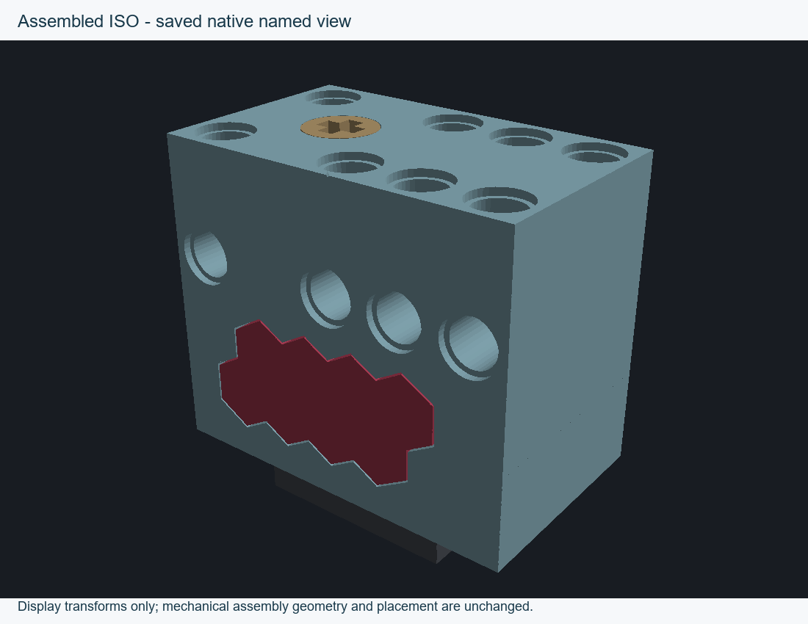
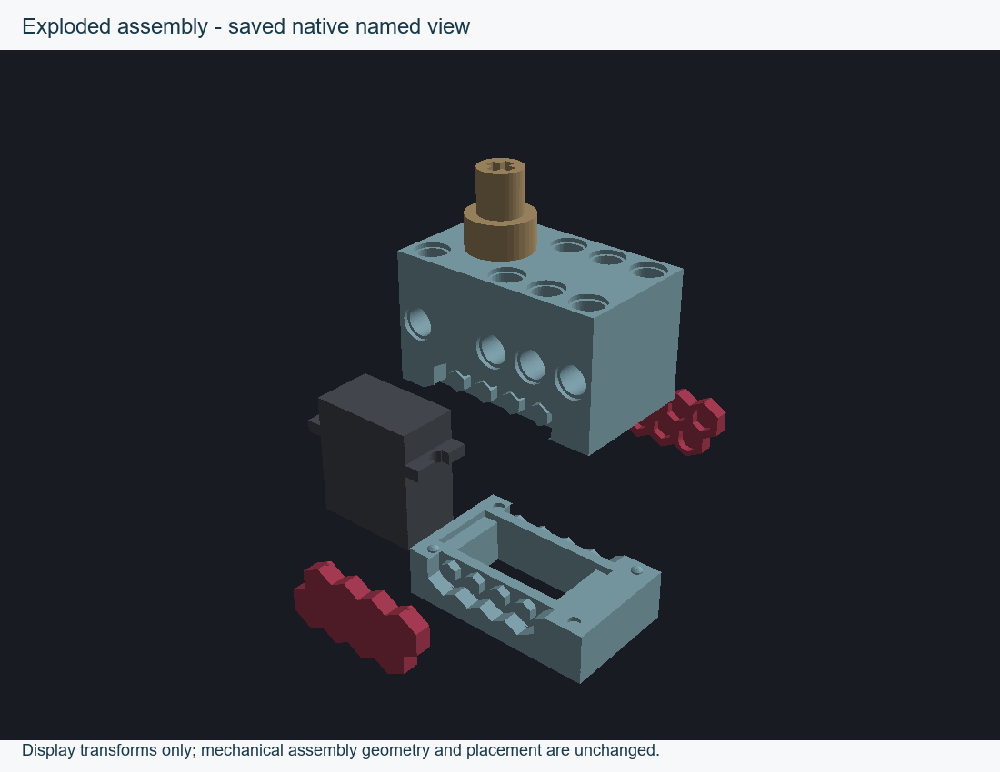
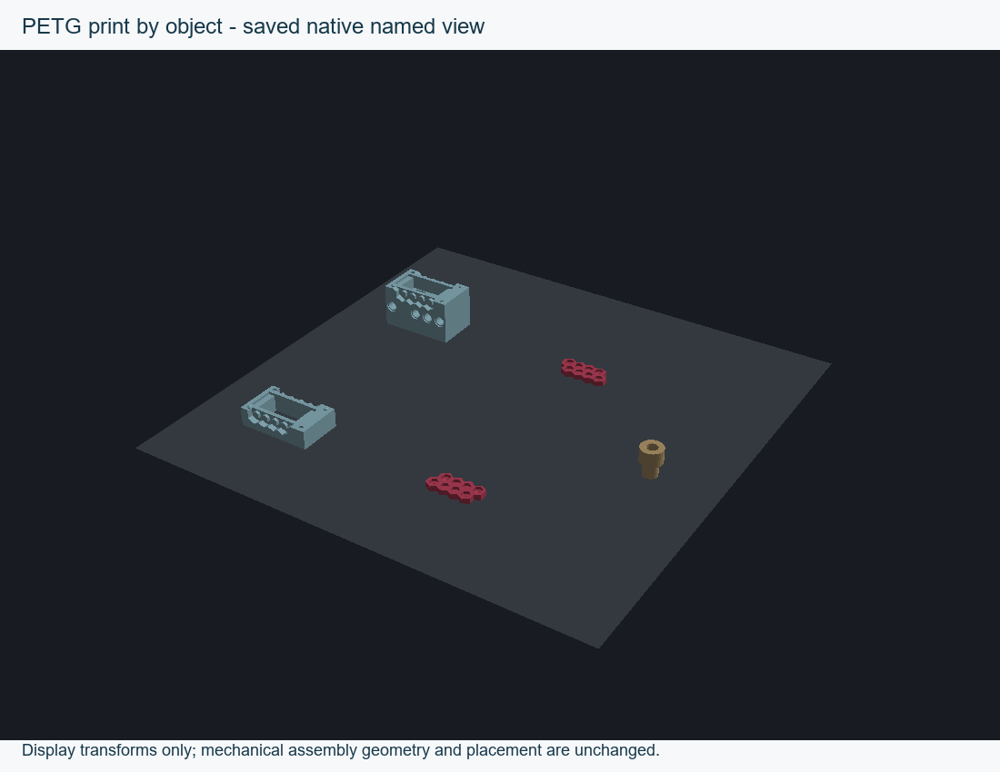
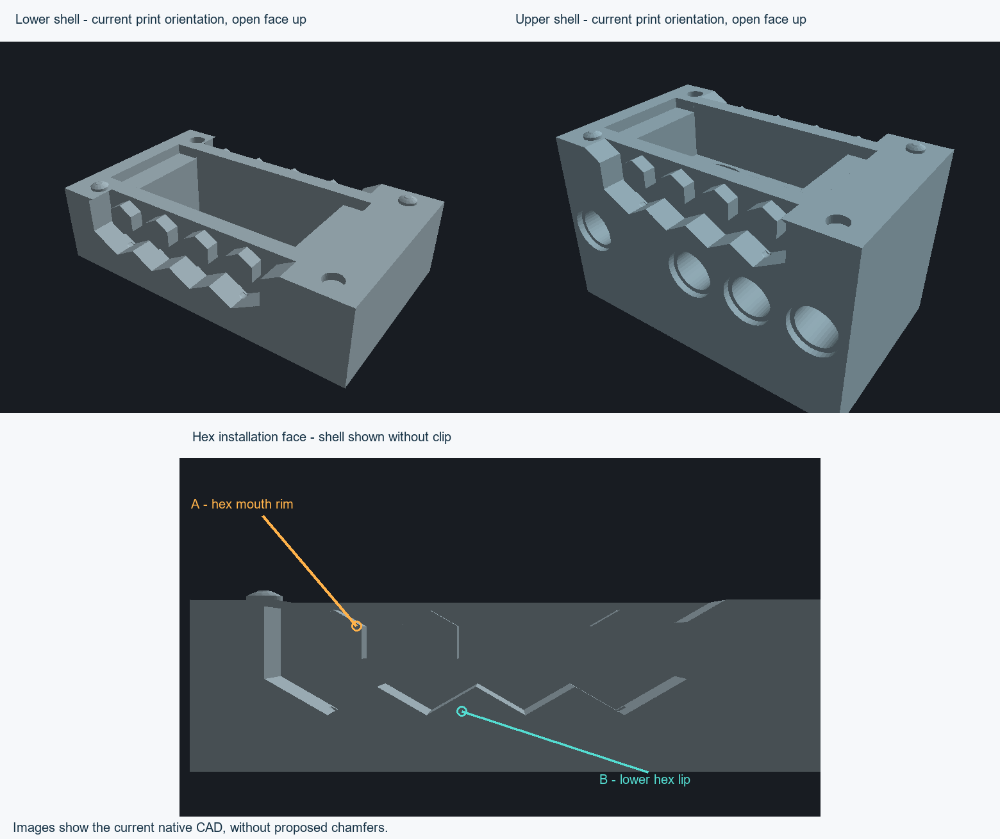

# Named views and PETG print layout — 8 October 2026

Follow-up: the A/B surface question below is resolved. Jeff identified the build-plate-facing underside of the projecting hex features. See the [measured underside trials](../hex-underside-20261008/README.md); their small bevels were not promoted to the active design.

The canonical native project now contains **Assembled ISO**, **Exploded assembly** and **PETG print by object**, alongside the existing corner inspection view. They store cameras, visibility and occurrence display transforms. Mechanical assembly placement, all seven solid meshes, topology and all 374 features remain unchanged. The new [preservation reference](../print-layout.json) checks every solid against the previous hub revision; earlier references remain untouched.

## Printing configuration

[Sequential baseline project](assembly-petg-sequential-no-brim.3mf): Bambu X2D, 0.4 mm nozzle, Bambu PETG Basic. The hub object brim is disabled; hub-only tree supports and their footings remain. Existing hub six-wall, fully solid, 0.08 mm quality settings remain. Shells and clips keep their previous settings. Both shell interiors face upward; clips have their outer broad faces down. No printer job was sent.

Objects are spaced for print by object, with a minimum bounding-box gap of 66.125 mm. The native profile specifies a 60 mm maximum clearance radius and 32.8 mm height to the rod; the tallest part is 24.45 mm. Native slicing passes without warnings. Actual G-code contains five successive complete object groups. Baseline estimate: 2 h 58 min 50 s, 23.04 g. This validates the saved profile's collision envelope; actual machine accessories and firmware still need to match that profile.

## Clip settings experiment

[Finer clip candidate](assembly-petg-sequential-clip-quality.3mf) tests both clips at 0.08 mm layers, outer walls limited to 25 mm/s, inner walls 40 mm/s, top surfaces 25 mm/s, gap fill 30 mm/s and solid fill 60 mm/s. First layer stays 0.20 mm. Clip top/bottom shell thickness is 3 mm to keep their 2.95 mm height fully solid. Estimate: 3 h 9 min 7 s, 23.05 g. This candidate is saved separately for comparison; it is not a mechanically qualified improvement.

The previous clip toolpaths already contain zero sparse infill segments. The finer candidate also contains zero. Extra local infill modifier volumes therefore offer little benefit here. The useful experiment is finer contour resolution and slower small features while retaining the four requested walls and corner relief geometry. Do not add material to the flex zones as a presumed strength fix without checking insertion force.

## Reported hex failure remains unresolved

The shell print orientations already put both interiors upward. The native tessellation identifies planar hex-region undersides at approximately **60 degrees from vertical**, a plausible source of unsupported first strands. This is an overhang measurement, not proof of bed-adhesion failure. [Measured faces](hex-overhang-audit.json) record IDs, normals and bounds.

The requested 25–30 degree target is interpreted from vertical/build direction. A small equal-distance chamfer does not guarantee that target, and removing material from a hex rim can reduce locating engagement. Surface selection is pending: **A** is the central hex-post mouth rim; **B** is the lower outer hex lip/underside. No chamfer, locating surface or detent seat has been changed. The reported failure supersedes the earlier blanket fit-print readiness statement: the print projects are review candidates until this edge treatment is resolved and physically tested.

## Evidence and reproduction

[Native view audit](named-view-audit.json), [resolved occurrence poses](named-view-solutions.json), baseline [slice](assembly-petg-sequential-no-brim-slice.json)/[toolpaths](assembly-petg-sequential-no-brim-audit.json), and finer-clip [slice](assembly-petg-sequential-clip-quality-slice.json)/[toolpaths](assembly-petg-sequential-clip-quality-audit.json) are saved with both projects. Resolved slicer configurations and CLI results/logs are in their corresponding subdirectories. Mesh entries are verified byte-identical to the previous project; socket interiors remain clear in sampled path checks.

Run `node tools/verify-current.mjs` for canonical CAD checks. Review scripts record local native CAD/slicer paths; rendering dependencies and native G-code remain outside Git at `D:/noBS-CAD-Reviews/INJS2065-Technic-Case/print-layout-20261008`. G-code SHA-256 hashes are in the slice records. No Bambu source code or external reference content is copied.
