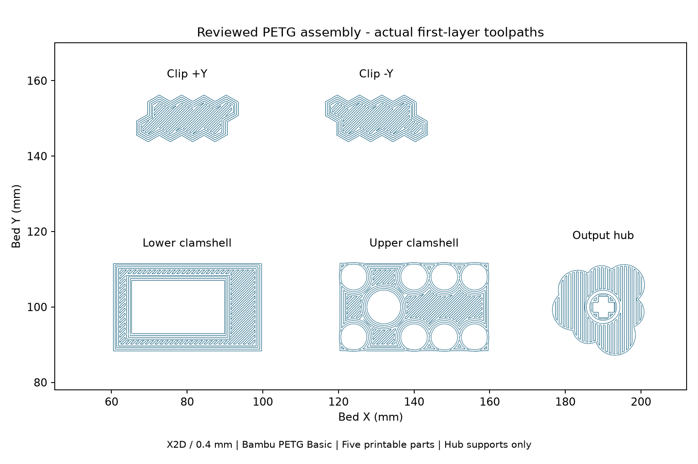
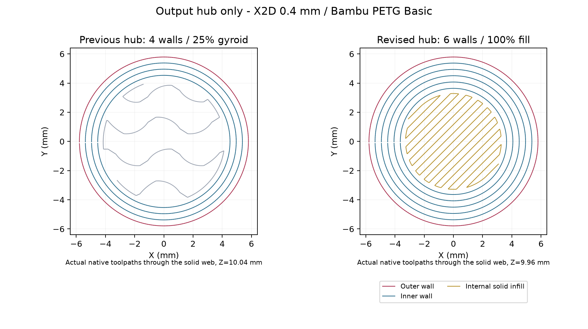

# Full print-readiness review - 8 October 2026

**Decision: ready to print the complete Bambu PETG Basic assembly as a fit/strength-test candidate.** No CAD or print-profile changes were needed during this review. This does not qualify repeated-service strength, preload or fatigue life.

Use [the verified five-part project](../hub-quality-20261008/assembly-petg-hub-quality.3mf). It contains both shells, both mirrored clips and the output hub; servo and bearing are purchased hardware. Its SHA-256 is `bf230d9cb46f39bb34dd99963cd3243530f1b7ee74d16c4e1408f289e300d596`. Bambu Studio's open window is `assembly-petg-hub-quality`; no print was sent.

## CAD, mesh and visual review

A fresh `node tools/verify-current.mjs` run passed: 374 features, seven reviewed meshes/topologies, six preserved bodies unchanged, expected assembly contacts and zero native errors. The native project archive's parsed model matches the canonical JSON. Fresh native replay reproduces the saved exact interference result: only four intended housing/clip contact groups interfere, each about 0.00002936 mm3. The hub has no modeled interference. This comparison is not a hardware fit or nonlinear contact solution.

All five actual mesh resources inside the current 3MF were independently checked: correct resource hashes and triangle counts, finite coordinates, valid indices, no collapsed triangles after 0.00001 mm welding, closed two-incidence edges, consistent winding, one connected component each and positive volumes matching the export manifest. This is not a separate triangle self-intersection test; native replay and exact assembly checks provide additional geometry evidence.

The [hub ISO/section](../hub-friction-20261007/hub-friction-views.png), [detent corner views](../revision-20261007/detent-corners.png) and [native installed sections](../revision-20261007/sections.png) were visually reviewed. Fresh mesh equality establishes their continued relevance. Full clip walls, eight blind hex pockets per clip, rounded four-corner nubs, blended inner relief and hidden housing receivers remain intact. No isolation groove or servo-side accidental tabs are present.

Servo socket remains diameter 5.70 mm, depth 3.70 mm, with a 0.15 mm lead-in and friction retention only, matching the saved garden-auger pilot. Technic cross remains span 4.85 mm, arm width 1.85 mm and depth 8.00 mm. The socket separator is 4.00 mm; servo radial wall is 3.00-3.15 mm. Technic corners retain the confirmed minimum radial stock of 1.37457 mm.

## Fresh slicing and actual toolpaths

The exact saved project was sliced again in a new external output directory using Bambu Studio 2.8.2.61, X2D / 0.4 mm nozzle, and the resolved Bambu PETG Basic filament preset. Native process and result codes are zero; all five names, mesh counts and heights match; there is no plate warning. Estimated full-plate time is **2h50m40s**, material **23.04 g**. The small differences between native runs are retained rather than requiring identical G-code hashes.

Hub-only settings remain six requested wall loops, fully solid internal fill, 0.08 mm main layers and a 30 mm/s outer-wall limit. Six concentric bands appear through the wide separator section; fewer loops fit narrow regions. No hub Sparse infill segments remain. The explicit 16 mm hub-only shell-thickness override that enforces solid fill is documented in the [profile review](../hub-quality-20261008/README.md).

Shells and clips retain 0.12 mm main layers, four requested walls and 25% gyroid. Object-specific layer levels match their earlier slice; their total filament extrusion changes by less than 0.1 mm each. Geometry and configurations are unchanged; incidental upper-shell sequencing differences are recorded. The first layer remains 0.20 mm for all objects. Clips have their outer broad face on the plate, pockets upward; the hub has its Technic face downward and servo socket upward.

Actual path samples show no extrusion in either eroded socket interior: servo bore above its floor and Technic cross below its floor, including support paths for the Technic test. These tests exclude material near walls/floors and do not establish printed dimensions or swept-bead clearance. Supports remain confined to the hub region. Object bounding-box gaps are at least 20 mm and object-only bed margin is at least 60 mm; hub supports also remain comfortably on the plate.

Resolved nozzle settings are 245 C first layer / 250 C subsequent layers, with a 70 C Textured PEI bed. These fall within the manufacturer's recommended 230-260 C nozzle / 65-75 C bed ranges. [Bambu PETG Basic TDS V3](https://store.bblcdn.com/s1/default/cb94589bf7994fdcbfa833badefae9cd/Bambu_PETG_Basic_Technical_Data_Sheet.pdf). Use dry filament and the selected plate/profile; physical filament condition and printer setup were not remotely inspected.

## Physical acceptance after this print

1. Seat the servo hub fully and check for splitting, rocking, axial pull-off and torque slip. Matching the successful auger pilot does not establish this compact hub's torque capacity.
2. Check free hub rotation in the bearing and housing. Nominal hub/bearing radial clearance is only 0.03 mm; upper-housing/hub clearance is 0.105 mm. Printed bore/journal tolerances can consume these gaps. Do not force a binding assembly.
3. Confirm all four detents seat, flex inward toward their pockets and retain the clip without rattle or permanent set. Nominal local inward holding shift is 0.02257 mm, small relative to printing variation. Check retention again after a seated dwell and repeat insertions.

The latest [mechanics review](../revision-20261007/REVIEW.md) reports approximately 4.15-5.04 N per nub in an assumed axial holding surrogate and local narrow-patch principal strain peaks of 4.29-4.38%. Local peaks are not converged; supports/contact are idealized, and inclined cases add sensitivity. Dynamic insertion strain, actual preload, creep and fatigue remain unqualified. These results support physical testing rather than a claim of production reliability. No further geometry change is justified solely by these uncertain peaks before observing the printed pair.

## Evidence and reproduction

[Full project/mesh audit](full-project-audit.json), [fresh native slice](native-slice.json), [fresh toolpath audit](toolpath-audit.json). The source CAD hash and exact project hash are recorded in the machine-readable evidence. The fresh G-code remains outside Git at `D:/noBS-CAD-Reviews/INJS2065-Technic-Case/print-readiness-20261008/slice-final/plate_1.gcode`, SHA-256 `eef990b7a41b1814c314290e1ccd668e72a37713d221474a1b592be882ad86a5`.

Scripts retain the reviewed parser and local dependencies. To rerun, copy the linked 3MF and its hub-quality `assembly-project.json` into the external review directory, run `slice.py`, then `audit.py`, `full-project-audit.py` and `plate-view.py`. Run the repository's `node tools/verify-current.mjs` separately for native geometry and exact contact verification. No saved geometry or historical validation reference was modified.
