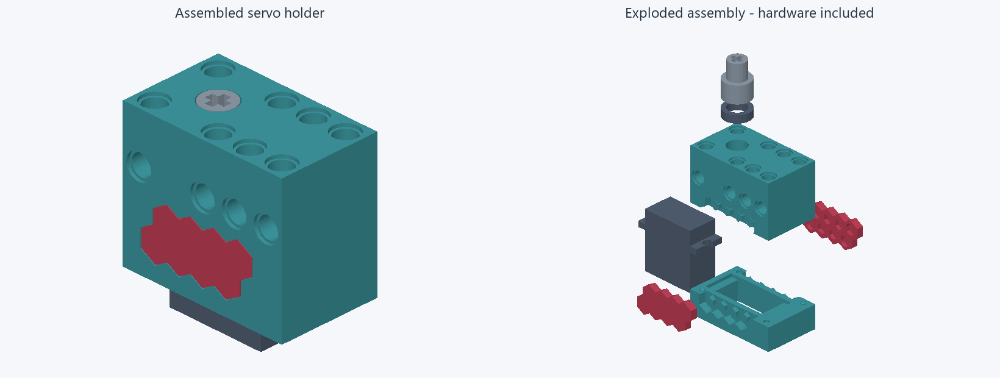
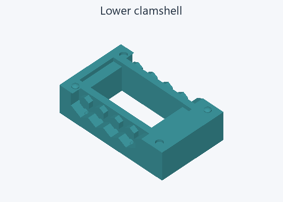
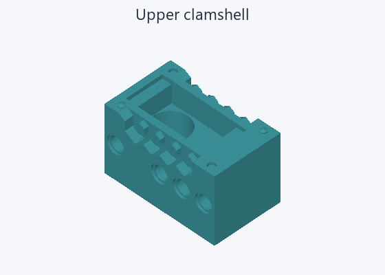
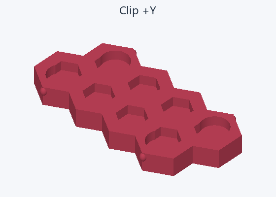
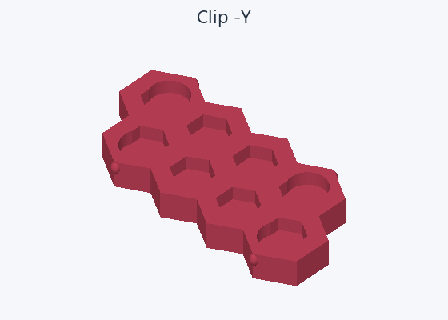
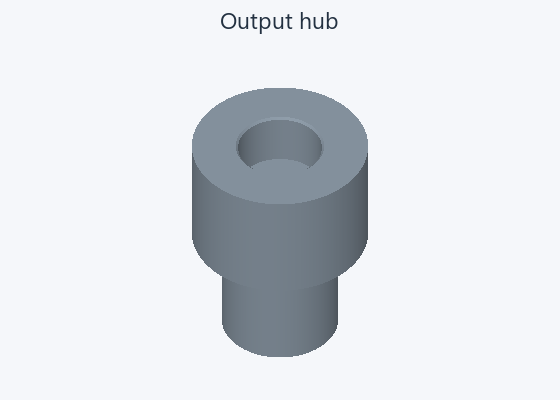
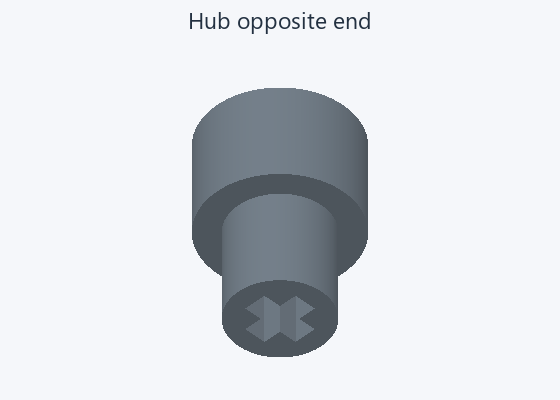
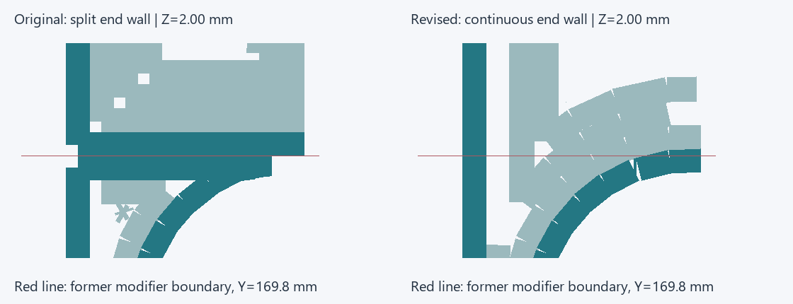

# Servo holder readiness review — 2026-11-06

Decision: proceed with a confirmation PETG print of
[assembly-uniform-shells.3mf](../grooves-20261105/assembly-uniform-shells.3mf).
Final mechanical acceptance remains pending. No print was started.

The operator reports that the previous print fits reasonably, with large end
grooves. The revised project preserves every printable mesh byte for byte,
the print placements, material and shell detail bands. All five meshes are
closed, connected and consistently wound, with positive volume and no duplicate
or collapsed faces at the existing 0.00001 mm welding tolerance. This does not
establish an exhaustive absence of self-intersections or strength.

A fresh native slice passes with five objects and no warnings or support,
brim or skirt extrusion. Both clips slice solid. The clip/hub extrusion geometry
matches the earlier slice. The former modifier boundaries now have continuous
end-wall paths: 1,020 restored layer/boundary crossings, with no loss of a
previously continuous crossing at the eight checked positions across both shells.
These are crossings, not 1,020 distinct layers or printed measurements.

Five printable parts:

Purchased hardware: INJS2065 servo and MR128 bearing, visible in the exploded
view. They are intentionally absent from the slicer plate. Individual part
images are rendered from the exact printable meshes; the assembly image uses
the unchanged CAD bodies. Display offsets in the exploded view are not gaps.

The end-wall illustration uses commanded extrusion centerlines and bead widths.
It is a magnified detail, not a prediction of the printed surface. Dark teal
shows outer walls, pale teal other extrusion, and red the former boundary.

After printing, accept only if both shell ends have no repeated groove at the
old boundaries; unsupported hex undersides allow full clip seating; both clips
retain without loose sliding, whitening or permanent set; and the bearing/hub
rotate freely with the servo engaged and transmit the intended torque without
slipping or axial loss. Repeat insertion/removal cycles and a loaded holding
dwell. Quantified force, creep and fatigue qualification remain open.

The older `print/assembly-petg.3mf` and `print/fit-test-petg.3mf` still contain
the regional modifiers; use the linked revised assembly for this print.
The older CAD/slice review remains useful as history, not as the final finish
acceptance of this revised slice. No new CAD replay or structural solve was
needed because the editable CAD, native-model consistency and printable meshes
are unchanged.

Evidence: [readiness.json](readiness.json). Reproduce with
`uv run --with pillow python tools/review-readiness.py` from the repository root.
Local ignored native output belongs to this servo-holder review, budget 50 MB,
retained until printed review is settled and no evidence consumer needs it.
