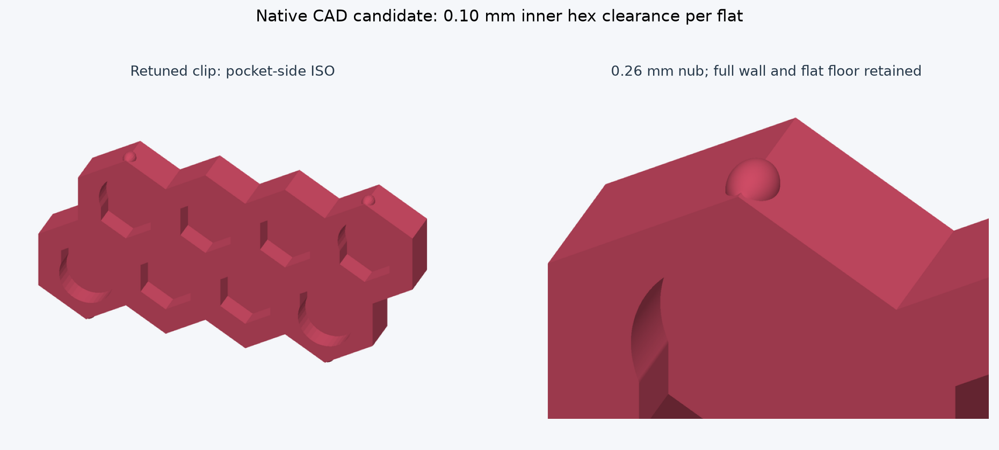
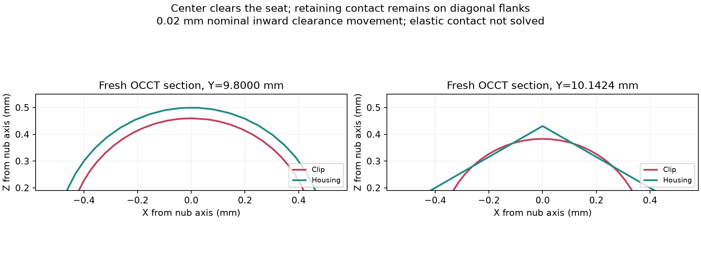

# Retuned retaining-fit candidate - 9 October 2026

**Print the mating coupon first. This revision is not qualified for a full functional assembly.** It addresses the demonstrated locating clearance and detent-margin weakness. Physical snap, preload, insertion travel, creep and retention still need testing. No printer job was started.

The canonical files now contain this reviewed candidate: [current native CAD](../../design/current.nbcad), [native history](../../design/current.model.json). The [PETG coupon](retention-coupon.3mf) contains two cropped receiving halves and three complete clips. The [full candidate project](assembly-fit-candidate.3mf) is retained for inspection; its existence is not a full-print recommendation.

## Changes

Inner clip hex pockets shrink from 1.95 to 1.85 mm half-width across flats. The existing housing posts remain 1.75 mm, giving **0.10 mm clearance per mating flat**, previously 0.20 mm. Outer clip profiles and the housing's outer hex mouths remain unchanged; their nominal clearance remains 0.20 mm. The tighter inner interface controls locating play without changing the visible housing pattern.

The four centered nubs per clip grow from **0.20 to 0.26 mm protrusion**. Their axes and Y = +/-9.80 mm midpoints are unchanged. The meridian remains symmetric, with a 0.80 mm crest radius and tangent **0.214 mm** outer blends. Its ends remain at |Y| = 9.08 and 10.52 mm, inside the original wall depth. The small outer blend is slightly larger than half the 0.4 mm nozzle diameter; this geometric observation is not proof that the slicer reproduces that radius. Actual commanded-width paths were checked separately.

The hidden R0.50 receiving seats have cylindrical portions from |Y| = 9.12 to 9.809663 mm, then rounded caps ending at 10.309663 mm. They are relieved for **0.020 mm nominal inward kinematic holding movement**. This is not measured elastic preload. The crest has approximately 0.040 mm radial clearance at its midpoint. Holding still acts on diagonal flanks, with a broader retaining nub behind the seat boundary.

Full continuous walls, eight blind hex pockets per clip, the R2 corner relief and flat pocket floors remain. The minimum in-plane relief wall remains approximately **0.898 mm**; the **1.45 mm backing** is unchanged. The three untouched servo/bearing/hub bodies are exactly preserved. Existing R0.25 side-wall fillets were rebound where needed after changing the inner profiles. All 390 features and existing body IDs, assembly poses and named views remain.

[Exploded CAD inspection](exploded.png) uses display offsets only. No deformed rendering is presented.

## Mechanical limits

The earlier printed failure is documented in [the investigation](../loose-fit-20261009/README.md). The cached job matches the preceding flat-floor geometry; the physical result supersedes its readiness statement.

The revised nub crest radius from its revolve axis is 0.46 mm. The diagonal housing flank distance remains b = 0.373205081 mm. Its central meridian is r(Y) = -0.34 + sqrt(0.80^2 - (Y - 9.80)^2), in mm. The receiving cap reaches that flank at |Y| = **10.142406557 mm**. The nub reaches the same radius at 10.162406557 mm, yielding the 0.020 mm local rigid-envelope shift.

Maximum crest overrun against an unrelieved flank increases from 0.026795 to **0.086795 mm radially**. At an unrelieved flank crossing the crest, the same translated-meridian construction gives **0.362407 mm** axial clearance movement. This is an envelope screen, **not a solved peak insertion displacement**: real frame rotation, contact redistribution, combined bending directions and the moving housing edge remain unresolved. Do not treat the small installed holding target as the maximum insertion movement. Rigid assembly approach still encounters obstruction, recorded in [the insertion audit](insertion.json).

The existing backed frame is not a free-ended cantilever. Preserving its full walls and flat backing limits the available flex mechanisms. The desired inward motion perpendicular to the broad face has not been established by a unilateral contact solution or a physical observation. Increasing the nub alone does not establish a safe snap mechanism.

## Fresh PETG strain screen

The final clip STEP was remeshed at two levels. [Coarse mesh](mesh-0.12.json) and [fine mesh](mesh-0.09.json) records include hashes, solid volume, node counts and positive element quality. The existing linear tetrahedral experiment was rerun with E = 2780 MPa and assumed Poisson ratio 0.38. The stiffness basis is the earlier [Bambu PETG Basic technical data sheet](https://store.bblcdn.com/s1/default/cb94589bf7994fdcbfa833badefae9cd/Bambu_PETG_Basic_Technical_Data_Sheet.pdf); isotropic solid stiffness is not calibrated printed-part behavior.

At **0.020 mm prescribed mean axial patch movement**, the final fine mesh gives approximately **7.71-9.02 N per patch** across footprints and supports. These reactions are **not measured preload, snap force or withdrawal force**. Final fine maximum absolute principal strains are about **2.39-2.44%** for the broad crest footprint, **3.33-3.39%** for wide flank patches, and **6.43-6.52%** for narrow patches. Local peaks are unconverged and stresses exceed a credible linear elastic material range in several cases. They are warnings about the load assumptions and contact concentration, not physical strain bounds or safety factors. [Coarse results](patch-sensitivity-0.12.json), [fine results](patch-sensitivity-0.09.json).

The scripts check the affine elasticity patch, mesh volume, positive elements, residual, force/moment balance, energy/work and compliance reciprocity. These checks validate the numerical experiment, not its assumed boundary conditions. There is no solved insertion contact, calibrated orthotropy, plasticity, friction, creep or fatigue. PLA remains unqualified.

A preliminary **0.05 mm holding target** was rejected after its screen showed high reactions and concentrated strain. [That retained screen](rejected-preload005-screen-0.12.json) used a preliminary longer outer blend, not the final geometry. It is evidence for reducing the target, not a final-geometry result. The final shorter blend also removes the small unwanted extension beyond the clip front. Never extrapolate those preliminary results into a print-readiness claim.

## Native and toolpath checks

[Geometry audit](geometry-audit.json): seven bodies, 390 successful features, zero native errors, three unchanged exact meshes, and only the four expected housing/clip contact pairs. Nominal overlaps are about 0.000122675 mm3 per pair, compared with 0.00002936 mm3 previously. Overlap volume alone does not determine holding force.

[Preserved sections](preserved-sections.json) show both +/-Y housing mouths unchanged at |Y| = 12 mm. Clip outside sections at |Y| = 12 mm and complete backing sections at |Y| = 10.6 mm match the previous revision at 0.00001 mm coordinate rounding. The outer clip hex profiles and R2 relief are exactly unchanged. These checks address the visible pattern and the removed floor-indent requirement.

Both 3MF projects slice successfully with no native warnings on **Bambu X2D / 0.4 mm / Bambu PETG Basic**, 0.16 mm main layers and 0.20 mm first layers. These test settings intentionally match the printed job's main layer height; the previous reviewed export was 0.12 mm. Requested walls remain four and global infill 25% gyroid. The narrow clip regions still slice solid. Coupon supports and brims are off; the full project's existing hub-only 0.08 mm settings and supports are retained. No contour/hole compensation was introduced. Inherited job titles and thumbnails were removed/replaced so these files identify their actual revision.

The [full-project slice](assembly-fit-candidate-audit.json) estimates **2 h 29 min 33 s, 23.11 g**. The [coupon slice](retention-coupon-audit.json) estimates **48 min 35 s, 5.03 g**. [Mesh audit](mesh-audit.json) checks all ten project meshes: closed with two incident triangles per welded edge at 0.00001 mm, connected, positive volume.

[Paired full-project toolpaths](all-corners.json) cover all eight nubs at three planes near the current holding boundary. All 24 sampled nominal sections have overlap. A hypothetical 0.01 mm erosion per mating surface leaves contact in all samples; 0.03 mm removes it in 13 of 24; 0.04 mm removes it in all 24. The previous printed design lost contact in all 24 at 0.03 mm. **This is an improvement, not a validated tolerance guarantee.** Erosion represents a sensitivity example, not measured PETG shrinkage or print error. Commanded-width capsules and constant layer slabs do not capture physical bead shape, deformation or contact force.

The [coupon path screen](coupon-corners.json) independently includes its cropped receivers and all three actual clip toolpaths. Coupon and full housing build directions match. The upper coupon is cropped at Z = 27.6 mm, 14.4 mm below the original Z = 42 mm print face, preserving the nominal 0.16 mm layer phase; its lower half retains the original Z = 8 mm print face. Cropping reduces housing support volume, so passing the coupon will still require a subsequent full-assembly check.

## Coupon use and acceptance

The shared receivers fit three labeled complete clips: **0.24 mm looser**, **0.26 mm nominal**, **0.28 mm tighter**. Inner locating clearance is 0.10 mm per flat for all three. They share the same receiver geometry; installed envelope holding movement is respectively approximately **-0.0224 mm** (clearance), **0.0200 mm**, and **0.0569 mm**. The tighter clip is an aggressive calibration bound, not the recommended default or a strength-qualified part. Native interference checks find no volumetric overlap for the looser clip, and the four intended pairs for the nominal and tighter versions. Slicer rounding may change their physical ordering or measured force.

Keep the two receiver halves aligned and supported in their assembled pose while checking a clip; testing one half alone does not reproduce the four contact locations. Start with the looser clip to assess locating fit, then compare snap, seating and rattle. Do not force an obstructed clip. Record which variant retains, whether flex occurs inward perpendicular to the broad face, any whitening/permanent set, and retention after dwell. The winning size and receiver relief should be selected from these measurements rather than another nominal-only readiness assertion. A pass on this coupon does not qualify repeated service use, fatigue or PLA.

## Reproduction and verification

Run `node tools/verify-current.mjs`: the new independent reference is [retention-fit.json](../retention-fit.json), preserving the servo, bearing and hub against the unchanged flat-floor reference. This check now passes for the intentional revision. The old upper-shell export mismatch remains recorded with the old source; no historical golden was silently rewritten or retroactively passed.

`build.mjs` edits the existing native pockets, nub and receiver and repairs the existing sidewall blends where required. Its final defaults are 0.26 mm nub / 0.02 mm holding target. For original-source replay recover `design/current.model.json` from `6c36d88`; run against an isolated source rather than executing old recipes as the current design. `audit.mjs`, `preserve.mjs`, `projects.py`, `mesh-audit.py`, the path-screen scripts, `mesh.py`, `strain.py` and `render.py` record the checks. They have explicit local Windows paths and are investigation evidence, not portable application features. Native STL export in the current application is ASCII; the project builder supports both ASCII and binary STL.

Large meshes, fields, original G-code and intermediate experiments remain at `D:/noBS-CAD-Reviews/INJS2065-Technic-Case/retention-fit-20261009`. Final compact receipts, sections, figures, STEP, native coupon/variant projects and tested 3MF files are versioned here. Canonical native archives and model payloads match byte for byte.
