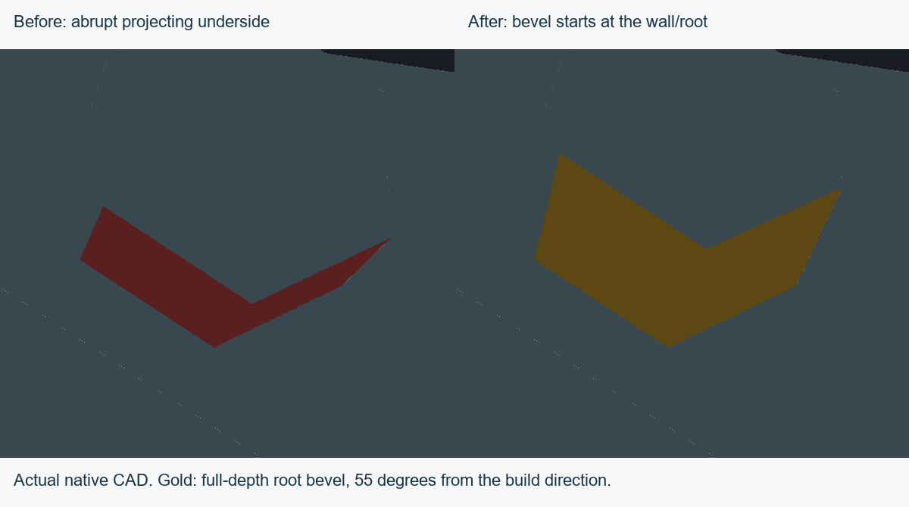
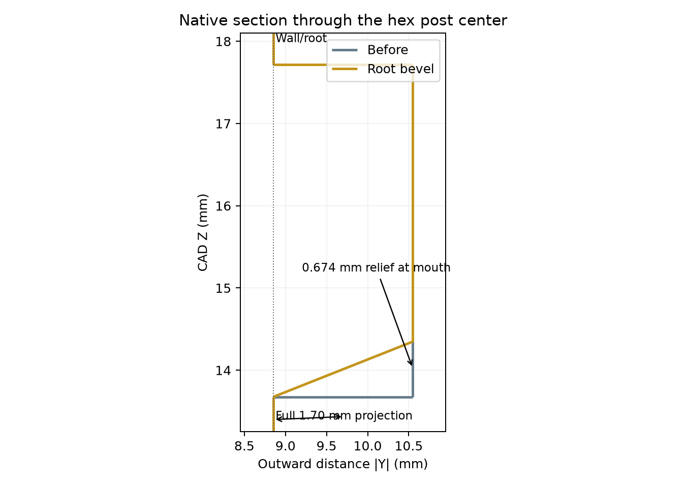
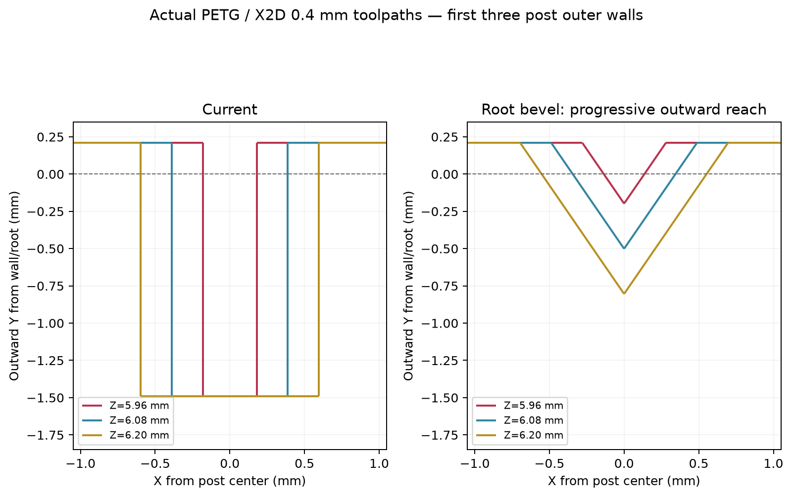

# Root-started hex bevels — 8 October 2026

The current CAD now bevels the build-plate-facing undersides of **all 16 hex locating posts**, starting at their wall/root and continuing to their mouths. The earlier lip-only trial addressed the wrong starting point. Jeff authorized a larger angle to improve the initial cantilever without requiring the original strict 25–30 degree target.

## Geometry and fit

The new faces measure **55 degrees from vertical**, or 35 degrees above horizontal on the face's steepest slope. They span the full 1.70 mm projection and relieve **0.67350 mm at the mouth**, with zero relief at the root. The hex sides also incline across X: the root-to-mouth YZ section consequently measures about 68.4 degrees from vertical. These are different measurement directions on the same compound face, not interchangeable angles.

Original root sections, upper locating surfaces and assembly envelopes remain. The front center height becomes approximately **3.368 mm** from 4.041 mm; the remaining straight side engagement at the mouth is approximately **1.347 mm** from 2.021 mm. The underside/mouth geometry intentionally changes. Do not infer unchanged local post strength solely from unchanged overall bounds or small mass loss.

Each shell loses approximately 16.029 mm³: 0.284% of the lower shell and 0.107% of the upper. Both clips, their nubs and corner flex reliefs, hub, servo and bearing meshes are unchanged. The exact CAD assembly check retains the four intended clip contact-pair overlaps within numerical tolerance and introduces no additional interference pair or clearance-state change. The upper posts are staggered **2.95 mm** in X; the upper bevel cutters include that offset.

An added root support trial at 50 degrees interfered with the clip. The accepted bevel removes underside material and preserves the nominal fit. The final source has **390 valid native features and seven bodies**: one shared cutter seed, pattern, mirrors and upper-row offset produce the repeated bevels. No failed experimental feature is included. The five other solids are preserved against the previous independent [reference](../print-layout.json); the new [root-bevel reference](../root-bevel.json) records the intentional shell revisions.

## Actual slicing

[Current full PETG assembly project](assembly-petg-root-bevel.3mf): X2D / 0.4 mm, Bambu PETG Basic. Global settings, object placement, both clip settings, hub settings and the three unchanged printable mesh entries are preserved. Shells and clips use 0.12 mm main layers, hub 0.08 mm, first layers 0.20 mm. Hub tree supports remain and its object brim remains disabled. Print by object remains enabled.

The first lower-post extrusion's outward centerline reach decreases from **1.490 mm to 0.198 mm**, then increases by approximately **0.303 mm per 0.12 mm layer** until full depth. The first upper-post extrusion reaches **0.047 mm**, rather than 1.490 mm, because its layer phase differs. All 16 posts were checked across every extrusion feature in these starting regions; each starts with less than half its previous reach. These are actual native G-code measurements, not swept-bead or physical sag predictions.

Native Bambu slicing passes without warnings; actual G-code retains five consecutive complete object groups. All five printable meshes are closed, consistently wound, connected and positive-volume. Fine shell export uses 0.0005 mm linear and 0.04 rad angular deflection. The hub and clips still contain no sparse infill, and sampled hub socket interiors remain clear. Estimated complete print: approximately **2 h 59 min 17 s, 23.00 g**. No printer job was sent.

This is ready for a **PETG fit/printing test**. Reduced initial reach supports the intended printing improvement, but printed post strength, defect removal, servo friction retention, detent preload and endurance remain physical acceptance checks. The earlier clip strain estimates describe unchanged clip geometry; this revision does not independently qualify the beveled posts' load capacity.

## Views and evidence

Native named views are retained: [assembled](assembled.png), [exploded](exploded.png), and [print by object](print-layout.png). Images use the current native meshes and resolved occurrence poses.

[Build audit](build-audit.json), [geometry measurements](geometry-audit.json), [complete fit check](candidate-fit.json), [mesh/toolpath audit](print-audit.json), [native slice](root-ramp-slice.json), [project manifest](assembly-project.json), and [source provenance](source.json) are saved. Run `node tools/verify-current.mjs` for fresh canonical replay. Native archive and canonical model payloads match.

Reproduction scripts use source commit **f85e290**, the recorded native CAD binary, Bambu Studio, and the local review dependencies. `build-root-ramps.mjs` builds the shared root cutters; `finalize-export.mjs` performs naming/fine export; `slice-root-ramp.py` builds and slices the project. Experimental sources, previous canonical backups, fine STLs and G-code remain in `D:/noBS-CAD-Reviews/INJS2065-Technic-Case/root-ramp-20261008`. The G-code hash is in the saved slice and print audit. Historical references and earlier experiments remain unchanged.
